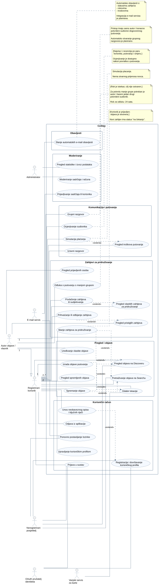

# 3. Obrasci uporabe

**Cilj:** Prikazati glavne interakcije između aktera aplikacije i sustava. Opišite kako akter ostvaruje cilj i što se događa kada važan korak ne uspije. Interakcije temeljite na odobrenim zahtjevima i ažurirajte ih kako se aplikacija razvija.

## 3.1 Dijagram obrazaca uporabe

**Cilj:** Prikazati granicu sustava, relevantne aktere i njihove glavne ciljeve u **preglednom UML dijagramu obrazaca uporabe**. Ako je za razumijevanje pojedinog dijela sustava potrebno prikazati više detalja, taj dio izdvojite u dodatni usmjereni dijagram. Dodatni dijagrami trebaju produbiti dio preglednog modela, a ne stvarati nepovezane ili duplicirane prikaze istog sustava.

**Slika 3.1. Dijagram obrazaca uporabe sustava CrisisMap**

**PlantUML izvor:** [izvor](./puml/3-1-costay-system-UC.puml)

**Provjera dijagrama:** Prikažite prepoznate uloge koje **komuniciraju s aplikacijom**, a ne dionike koji s njom nemaju interakciju. Svaki glavni korisnički cilj mora imati pridruženog aktera; uključeni obrazac uporabe može se dosegnuti preko drugog obrasca uporabe bez vlastite izravne veze s akterom. `<<include>>` i `<<extend>>` koristite samo kada odnos odgovara stvarnom ponašanju.

<strong>Primjer aktera i granica sustava</strong>

**Opis primjera — CrisisMap:**

Dijagram prikazuje **ogledni scenarij** s građaninom, posjetiteljem i koordinatorom pomoći te vanjskim pružateljem identiteta. Pružatelj identiteta sudjeluje u obrascu uporabe „Prijava u sustav” kao sekundarni akter: korisnik pokreće prijavu u aplikaciji, a vanjski sustav provodi autentikaciju. Budući da projekt koristi vanjskog pružatelja identiteta, ta se ovisnost prikazuje i u dijagramu obrazaca uporabe; tehnički detalji integracije pripadaju arhitekturnoj dokumentaciji.

**Odabir aktera i ciljeva:** Granica pokazuje što aplikacija nudi, akteri imaju različite ciljeve, a nijedan akter ni obrazac uporabe ne tvrdi da ova studentska aplikacija angažira hitne službe. Dijagram usporedite s odobrenim funkcijskim zahtjevima i akterima.

**Pet pitanja za odabir sadržaja dijagrama** (ne pet dijagrama za predaju):

| Fokus                   | Pitanje                                                                                                                     |
| ----------------------- | --------------------------------------------------------------------------------------------------------------------------- |
| Cijeli sustav           | Koji korisnički ciljevi najbolje objašnjavaju čemu ova aplikacija služi?                                                    |
| Ključne funkcionalnosti | Koje ciljeve treba detaljnije opisati ili, ako je potrebno, prikazati zasebnim usmjerenim dijagramom?                       |
| Korisničke uloge        | Koji akteri mogu sudjelovati u pojedinom cilju i kako se njihove ovlasti razlikuju?                                         |
| Ključni procesi         | Koji cilj ima važne alternative koje treba opisati u obrascu uporabe?                                                       |
| Vanjske integracije     | Sudjeluje li drugi sustav u obrascu uporabe kao **sekundarni akter**, primjerice odobreni pružatelj identiteta pri prijavi? |

Vanjski sustav može biti sekundarni akter obrasca uporabe kada sudjeluje u ostvarenju korisničkog cilja; tehničke veze opisuju se u arhitekturi. Nemojte stvarati dodatni obavezni dijagram obrazaca uporabe samo radi popisa integracija. Prenatrpan dijagram podijelite prema povezanim akterima ili ciljevima samo kada time postaje čitljiviji.

## 3.2 Specifikacije obrazaca uporabe

**Cilj:** Za svaki obrazac uporabe iz dijagrama objasniti cilj aktera, uobičajenu interakciju s aplikacijom i važne alternative. Jednostavne obrasce uporabe opišite kratko; proširite one kod kojih alternative, vanjske ovisnosti ili posljedice zahtijevaju dodatno objašnjenje.

**Za svaki obrazac uporabe koristite jednu okomitu tablicu.** Navedite samo onoliko pojedinosti koliko interakcija zahtijeva; neprimjenjivu alternativu izostavite umjesto da je popunjavate samo radi forme.

### UC-[ID]: [Naziv usmjeren na cilj]

| Element specifikacije             | Opis                                                                                                                                      |
| :-------------------------------- | :---------------------------------------------------------------------------------------------------------------------------------------- |
| **Primarni akter**                | [Uloga definirana u analizi zahtjeva]                                                                                                     |
| **Povezani zahtjevi**             | [Identifikatori funkcijskih zahtjeva, npr. F-001, F-004]                                                                                  |
| **Preduvjeti**                    | [Stanje sustava koje mora biti zadovoljeno prije početka izvođenja]                                                                       |
| **Glavni uspješni tok**           | 1. Akter pokreće akciju. 2. Program obrađuje unos i vraća povratnu informaciju. 3. [Koračni prikaz interakcije do ostvarenja cilja] |
| **Alternativni tokovi / Iznimke** | **[Korak]a — [Naziv iznimke]:** [Uvjet nastanka, reakcija programa i nastavak toka]                                                       |
| **Posljedice (ishod)**            | [Promjena stanja podataka ili potvrda nakon uspješnog završetka]                                                                          |

<strong>Primjeri specifikacija: Registracija i prijava kriznog događaja</strong>

**Primjer — CrisisMap:**

**UC-001: Registracija računa.** Ovaj kratki primjer odnosi se na projekt čiji odobreni zadatak uključuje račune s adresom e-pošte i lozinkom.

| Polje                                             | Opis                                                                                            |
| ------------------------------------------------- | ----------------------------------------------------------------------------------------------- |
| Primarni akter                                    | Građanin (A-02 u primjeru)                                                                      |
| ID zahtjeva                                       | F-001                                                                                           |
| Preduvjeti, ako postoje                           | Nema.                                                                                           |
| Glavni tijek                                      | Građanin unosi adresu e-pošte; aplikacija šalje poveznicu za potvrdu; građanin potvrđuje račun. |
| Alternativni ili neuspješni tijekovi, ako postoje | Adresa e-pošte već postoji → aplikacija objašnjava zašto se registracija ne može nastaviti.     |
| Rezultat                                          | Račun je aktivan nakon potvrde.                                                                 |

Ako odobreni zadatak umjesto toga koristi isključivo OAuth prijavu, zamijenite ovaj primjer odgovarajućim ponašanjem prijave; nemojte dodavati registraciju lokalnom lozinkom samo radi podudaranja s primjerom.

**UC-002: Podnošenje prijave kriznog događaja.** Ista polja mogu opisati dulji tijek u kojem odabir lokacije, provjera valjanosti i pohrana mogu ne uspjeti.

| Polje                                             | Opis                                                                                                                                                                                                                                                                                                                                                                                                                                                                                                                                                                                                                                                                                                 |
| ------------------------------------------------- | ---------------------------------------------------------------------------------------------------------------------------------------------------------------------------------------------------------------------------------------------------------------------------------------------------------------------------------------------------------------------------------------------------------------------------------------------------------------------------------------------------------------------------------------------------------------------------------------------------------------------------------------------------------------------------------------------------- |
| Primarni akter                                    | Građanin                                                                                                                                                                                                                                                                                                                                                                                                                                                                                                                                                                                                                                                                                             |
| ID zahtjeva                                       | F-004                                                                                                                                                                                                                                                                                                                                                                                                                                                                                                                                                                                                                                                                                                |
| Preduvjeti, ako postoje                           | Obrazac za prijavu dostupan je. Ako odobreni zadatak zahtijeva prijavu u sustav, građanin je prijavljen.                                                                                                                                                                                                                                                                                                                                                                                                                                                                                                                                                                                             |
| Glavni tijek                                      | 1. Građanin otvara obrazac za prijavu; aplikacija prikazuje polja za vrstu kriznog događaja, razinu ozbiljnosti, opis i lokaciju. 2. Građanin unosi podatke i odabire lokaciju na karti ili drugim podržanim načinom. 3. Građanin podnosi obrazac; aplikacija provjerava obavezna polja i lokaciju. 4. Aplikacija pohranjuje prijavu i prikazuje potvrdu s referencom na nju.                                                                                                                                                                                                                                                                                                               |
| Alternativni ili neuspješni tijekovi, ako postoje | **1a — Prijava u sustav nije uspjela:** Ako je prijava obavezna, a pružatelj identiteta je ne dovrši, prijava kriznog događaja ostaje nepodnesena i aplikacija objašnjava kako pokušati ponovno. **2a — Odbijen pristup lokaciji:** Ako aplikacija nudi geolokaciju, ali je korisnik odbije, građanin ručno odabire lokaciju ako ta mogućnost postoji; tijek se nastavlja u koraku 3. **3a — Nevaljana ili nedostajuća lokacija:** Aplikacija objašnjava problem, po mogućnosti zadržava unesene podatke i ne pohranjuje prijavu; građanin ispravlja lokaciju i ponavlja korak 3. **3b — Pohrana nije uspjela:** Aplikacija prijavljuje neuspjeh i ne prikazuje lažnu potvrdu o podnošenju. |
| Rezultat                                          | Aplikacija pohranjuje prijavu kriznog događaja i potvrđuje njezino podnošenje.                                                                                                                                                                                                                                                                                                                                                                                                                                                                                                                                                                                                                       |

**Odabir razine detalja:** Oba primjera koriste ista polja. UC-001 je kratak jer je glavna iznimka jasna; UC-002 zahtijeva numerirane korake i alternative jer oni mijenjaju ishod i mogu usmjeravati ispitivanje.Pri prilagodbi primjera koristite ID-ove zahtjeva i ponašanje vlastite aplikacije.

**UC-005: Moderiranje prijave kriznog događaja.** Ovaj primjer vrijedi samo za projekt u kojem odobreni opseg uključuje moderatorski pregled prijava.

| Polje                                             | Opis                                                                                                                                                                                                                                                              |
| ------------------------------------------------- | ----------------------------------------------------------------------------------------------------------------------------------------------------------------------------------------------------------------------------------------------------------------- |
| Primarni akter                                    | Moderator (A-05 u primjeru)                                                                                                                                                                                                                                       |
| ID zahtjeva                                       | F-008                                                                                                                                                                                                                                                             |
| Preduvjeti, ako postoje                           | Moderator je prijavljen i ima moderatorske ovlasti; postoji prijava koja čeka pregled.                                                                                                                                                                            |
| Glavni tijek                                      | 1. Moderator otvara prijavu koja čeka pregled. 2. Aplikacija prikazuje podatke prijave i dostupne moderatorske radnje. 3. Moderator odabire odobravanje ili odbijanje. 4. Aplikacija provjerava ovlasti, mijenja status prijave i prikazuje novi status. |
| Alternativni ili neuspješni tijekovi, ako postoje | **3a — Radnja nije potvrđena:** Moderator odustaje od promjene i prijava ostaje nepromijenjena. **4a — Ovlasti nisu valjane:** Aplikacija odbija promjenu i status prijave ostaje nepromijenjen.                                                               |
| Rezultat                                          | Prijava ima novi status ako je moderatorska radnja uspješno provedena; inače ostaje nepromijenjena.                                                                                                                                                               |

---

## 3.2 Specifikacije obrazaca uporabe

**Cilj:** Za svaki obrazac uporabe iz dijagrama opisati cilj aktera, glavni uspješni tok i značajne alternative.

Specifikacije UC-001 do UC-010 opisuju postojeće razrađene scenarije. Specifikacije UC-011 do UC-029 proširuju pokrivenost dijagrama obrazaca uporabe; njihovu usklađenost s implementacijom potrebno je potvrditi prije predaje.

### UC-001: Pregled objava na Discoveru

| Element specifikacije             | Opis                                                                                                                                                                                                                                                                                                                                                                       |
| :-------------------------------- | :------------------------------------------------------------------------------------------------------------------------------------------------------------------------------------------------------------------------------------------------------------------------------------------------------------------------------------------------------------------------- |
| **Primarni akter**                | Neregistrirani posjetitelj ili registrirani korisnik                                                                                                                                                                                                                                                                                                                       |
| **Povezani zahtjevi**             | F-005, F-022                                                                                                                                                                                                                                                                                                                                                               |
| **Preduvjeti**                    | Aplikacija je dostupna, a korisnik može pristupiti stranici Discover. Za prikaz personaliziranih preporuka korisnik je prijavljen u sustav.                                                                                                                                                                                                                                |
| **Glavni uspješni tok**           | 1. Korisnik otvara stranicu Discover. 2. Aplikacija dohvaća dostupne javne objave putovanja. 3. Ako je korisnik prijavljen, aplikacija prikazuje preporučene objave na temelju njegove povijesti pregledavanja. 4. Aplikacija prikazuje objave korisniku. 5. Dok korisnik pomiče stranicu prema dolje, aplikacija postupno dohvaća i prikazuje dodatne objave. |
| **Alternativni tokovi / Iznimke** | **2a — Nema dostupnih objava:** Ako trenutačno nema objava za prikaz, aplikacija prikazuje odgovarajuću poruku. **5a — Neuspješno dohvaćanje dodatnih objava:** Ako dohvaćanje dodatnih objava ne uspije, aplikacija obavještava korisnika o problemu i omogućuje mu ponovni pokušaj.                                                                                   |
| **Posljedice (ishod)**            | Korisniku su prikazane dostupne objave putovanja. Pregledavanje objava ne mijenja njihovo stanje.                                                                                                                                                                                                                                                                          |

### UC-002: Spremanje objave

| Element specifikacije             | Opis                                                                                                                                                                                                                                                                                                                         |
| :-------------------------------- | :--------------------------------------------------------------------------------------------------------------------------------------------------------------------------------------------------------------------------------------------------------------------------------------------------------------------------- |
| **Primarni akter**                | Registrirani korisnik                                                                                                                                                                                                                                                                                                        |
| **Povezani zahtjevi**             | F-007                                                                                                                                                                                                                                                                                                                        |
| **Preduvjeti**                    | Korisnik je prijavljen u sustav i postoji objava koju može pregledati.                                                                                                                                                                                                                                                       |
| **Glavni uspješni tok**           | 1. Korisnik otvara objavu koju želi spremiti. 2. Aplikacija prikazuje detalje objave i mogućnost spremanja. 3. Korisnik odabire opciju spremanja objave. 4. Aplikacija povezuje objavu s korisničkim računom i pohranjuje podatak o spremljenoj objavi. 5. Aplikacija prikazuje potvrdu da je objava spremljena. |
| **Alternativni tokovi / Iznimke** | **3a — Korisnik nije prijavljen:** Ako korisnik nije prijavljen, aplikacija zahtijeva prijavu prije korištenja funkcionalnosti spremanja. **4a — Objavu nije moguće spremiti:** Ako pohrana ne uspije, aplikacija obavještava korisnika o pogrešci i ne prikazuje potvrdu uspješnog spremanja.                            |
| **Posljedice (ishod)**            | Objava je spremljena na korisnički račun te je korisnik može naknadno pregledati na popisu spremljenih objava u svom profilu.                                                                                                                                                                                                |

### UC-003: Slanje zahtjeva za pridruživanje

| Element specifikacije             | Opis                                                                                                                                                                                                                                                                                                                                                                                                                                                   |
| :-------------------------------- | :----------------------------------------------------------------------------------------------------------------------------------------------------------------------------------------------------------------------------------------------------------------------------------------------------------------------------------------------------------------------------------------------------------------------------------------------------- |
| **Primarni akter**                | Registrirani korisnik                                                                                                                                                                                                                                                                                                                                                                                                                                  |
| **Povezani zahtjevi**             | F-008, F-010                                                                                                                                                                                                                                                                                                                                                                                                                                           |
| **Preduvjeti**                    | Korisnik je prijavljen u sustav i postoji objava čiji je status otvoren.                                                                                                                                                                                                                                                                                                                                                                               |
| **Glavni uspješni tok**           | 1. Korisnik otvara objavu putovanja kojoj se želi pridružiti. 2. Aplikacija prikazuje detalje objave i mogućnost slanja zahtjeva za pridruživanje. 3. Korisnik odabire opciju slanja zahtjeva. 4. Aplikacija provjerava je li objava i dalje otvorena. 5. Aplikacija pohranjuje zahtjev za pridruživanje sa statusom „na čekanju”. 6. Aplikacija prikazuje korisniku potvrdu da je zahtjev uspješno poslan.                             |
| **Alternativni tokovi / Iznimke** | **3a — Korisnik nije prijavljen:** Ako korisnik nije prijavljen, aplikacija zahtijeva prijavu prije slanja zahtjeva. **4a — Objava više nije otvorena:** Ako se status objave promijenio prije slanja zahtjeva, aplikacija obavještava korisnika da slanje zahtjeva više nije moguće. **5a — Neuspješna pohrana zahtjeva:** Ako pohrana zahtjeva ne uspije, aplikacija obavještava korisnika o pogrešci i ne prikazuje potvrdu uspješnog slanja. |
| **Posljedice (ishod)**            | Zahtjev za pridruživanje uspješno je pohranjen sa statusom „na čekanju”. Korisnik može pregledati status svojih zahtjeva. Zahtjev na čekanju ne povećava broj potvrđenih sudionika objave.                                                                                                                                                                                                                                                             |

### UC-004: Izravni razgovor

| Element specifikacije             | Opis                                                                                                                                                                                                                                                                                                                                                                                                                                                                                                                                                                                                                                                                                          |
| :-------------------------------- | :-------------------------------------------------------------------------------------------------------------------------------------------------------------------------------------------------------------------------------------------------------------------------------------------------------------------------------------------------------------------------------------------------------------------------------------------------------------------------------------------------------------------------------------------------------------------------------------------------------------------------------------------------------------------------------------------- |
| **Primarni akter**                | Registrirani korisnik                                                                                                                                                                                                                                                                                                                                                                                                                                                                                                                                                                                                                                                                         |
| **Povezani zahtjevi**             | F-012                                                                                                                                                                                                                                                                                                                                                                                                                                                                                                                                                                                                                                                                                         |
| **Preduvjeti**                    | Korisnik je prijavljen u sustav i sudionik je razgovora koji želi otvoriti.                                                                                                                                                                                                                                                                                                                                                                                                                                                                                                                                                                                                                   |
| **Glavni uspješni tok**           | 1. Korisnik otvara stranicu Inbox. 2. Aplikacija dohvaća i prikazuje popis razgovora u kojima je korisnik sudionik. 3. Korisnik odabire izravni razgovor s drugim korisnikom. 4. Aplikacija dohvaća i prikazuje do 100 najnovijih poruka odabranog razgovora. 5. Korisnik unosi tekst poruke i odabire opciju slanja. 6. Aplikacija provjerava ispravnost poruke i ovlasti korisnika za sudjelovanje u razgovoru. 7. Aplikacija pohranjuje poruku i prikazuje potvrdu uspješnog slanja. 8. Nove poruke sudionika prikazuju se u razgovoru putem Realtime komunikacije, bez potrebe za osvježavanjem stranice.                                                            |
| **Alternativni tokovi / Iznimke** | **2a — Nema razgovora:** Ako korisnik nema nijedan razgovor, aplikacija prikazuje odgovarajuću poruku. **3a — Razgovor nije dostupan:** Ako korisnik nije sudionik odabranog razgovora, aplikacija odbija pristup razgovoru. **6a — Nevaljana poruka:** Ako je poruka prazna ili dulja od 2000 znakova, aplikacija odbija slanje i prikazuje odgovarajuću poruku o pogrešci. **7a — Neuspješno slanje:** Ako pohrana poruke ne uspije, aplikacija obavještava korisnika da poruka nije poslana. **8a — Realtime veza nije dostupna:** Ako se nove poruke ne mogu primati u stvarnom vremenu, aplikacija obavještava korisnika o problemu i omogućuje ponovno uspostavljanje veze. |
| **Posljedice (ishod)**            | Poruka je pohranjena u razgovoru i dostupna njegovim sudionicima. Nove poruke prikazuju se sudionicima putem Realtime komunikacije.                                                                                                                                                                                                                                                                                                                                                                                                                                                                                                                                                           |

### UC-005: Grupni razgovor

| Element specifikacije             | Opis                                                                                                                                                                                                                                                                                                                                                                                                                                                                                                                                                                                                                                                                                                                                                          |
| :-------------------------------- | :------------------------------------------------------------------------------------------------------------------------------------------------------------------------------------------------------------------------------------------------------------------------------------------------------------------------------------------------------------------------------------------------------------------------------------------------------------------------------------------------------------------------------------------------------------------------------------------------------------------------------------------------------------------------------------------------------------------------------------------------------------ |
| **Primarni akter**                | Registrirani korisnik koji je autor objave ili konačno potvrđeni sudionik dogovorenog putovanja                                                                                                                                                                                                                                                                                                                                                                                                                                                                                                                                                                                                                                                               |
| **Povezani zahtjevi**             | F-012, F-013                                                                                                                                                                                                                                                                                                                                                                                                                                                                                                                                                                                                                                                                                                                                                  |
| **Preduvjeti**                    | Putovanje je dogovoreno i postoji grupni razgovor kojem pripadaju autor objave i konačno potvrđeni sudionici.                                                                                                                                                                                                                                                                                                                                                                                                                                                                                                                                                                                                                                                 |
| **Glavni uspješni tok**           | 1. Nakon dogovaranja putovanja aplikacija automatski stvara grupni razgovor. 2. Aplikacija dodaje autora objave i konačno potvrđene sudionike u grupni razgovor. 3. Sudionik otvara stranicu Inbox. 4. Aplikacija prikazuje grupni razgovor na popisu dostupnih razgovora. 5. Sudionik odabire grupni razgovor. 6. Aplikacija dohvaća i prikazuje do 100 najnovijih poruka grupnog razgovora. 7. Sudionik unosi tekst poruke i odabire opciju slanja. 8. Aplikacija provjerava pripadnost sudionika razgovoru, pohranjuje poruku i prikazuje potvrdu uspješnog slanja. 9. Nove poruke prikazuju se ostalim sudionicima putem Realtime komunikacije.                                                                                   |
| **Alternativni tokovi / Iznimke** | **1a — Neuspješno stvaranje razgovora:** Ako aplikacija ne uspije stvoriti grupni razgovor, obavještava odgovarajući dio sustava o pogrešci kako bi se stvaranje moglo ponoviti ili obraditi. **2a — Neuspješno dodavanje sudionika:** Ako dodavanje sudionika ne uspije, aplikacija ne smije omogućiti pristup razgovoru korisnicima koji nisu uspješno dodani. **5a — Korisnik nije sudionik razgovora:** Aplikacija odbija pristup grupnom razgovoru. **8a — Nevaljana poruka ili neuspješna pohrana:** Aplikacija odbija slanje nevaljane poruke ili obavještava korisnika da pohrana nije uspjela. **9a — Realtime veza nije dostupna:** Ako se nove poruke ne mogu primati u stvarnom vremenu, aplikacija obavještava korisnika o problemu. |
| **Posljedice (ishod)**            | Stvoren je grupni razgovor koji je dostupan autoru objave i konačno potvrđenim sudionicima dogovorenog putovanja. Sudionici mogu razmjenjivati poruke unutar razgovora.                                                                                                                                                                                                                                                                                                                                                                                                                                                                                                                                                                                       |

### UC-006: Registracija i dovršavanje korisničkog profila

| Element specifikacije             | Opis                                                                                                                                                                                                                                                                                                                                                                                                                                                                                                                                                                                                                                                                                                                                                                                                                                                                                                                                                                                                                                    |
| :-------------------------------- | :-------------------------------------------------------------------------------------------------------------------------------------------------------------------------------------------------------------------------------------------------------------------------------------------------------------------------------------------------------------------------------------------------------------------------------------------------------------------------------------------------------------------------------------------------------------------------------------------------------------------------------------------------------------------------------------------------------------------------------------------------------------------------------------------------------------------------------------------------------------------------------------------------------------------------------------------------------------------------------------------------------------------------------------- |
| **Primarni akter**                | Neregistrirani posjetitelj                                                                                                                                                                                                                                                                                                                                                                                                                                                                                                                                                                                                                                                                                                                                                                                                                                                                                                                                                                                                              |
| **Povezani zahtjevi**             | F-001, NF-07                                                                                                                                                                                                                                                                                                                                                                                                                                                                                                                                                                                                                                                                                                                                                                                                                                                                                                                                                                                                                            |
| **Preduvjeti**                    | Korisnik može pristupiti stranici za registraciju.                                                                                                                                                                                                                                                                                                                                                                                                                                                                                                                                                                                                                                                                                                                                                                                                                                                                                                                                                                                      |
| **Glavni uspješni tok**           | 1. Korisnik otvara registraciju i odabire Google ili GitHub. 2. Sustav preusmjerava korisnika na odabranog pružatelja identiteta putem Supabase Autha. 3. Korisnik uspješno potvrđuje identitet i vraća se u CoStay. 4. Sustav provjerava rezultat autentifikacije i utvrđuje da korisnik još nema CoStay profil. 5. Sustav prikazuje obrazac za obavezne podatke profila. 6. Korisnik unosi ime, prezime, datum rođenja, spol i mjesto stanovanja te šalje obrazac. 7. Sustav provjerava unesene podatke i punoljetnost te pohranjuje profil povezan s potvrđenim identitetom i adresom e-pošte. 8. Sustav prikazuje neobavezni korak unosa opisa i ključnih riječi.                                                                                                                                                                                                                                                                                                                                              |
| **Alternativni tokovi / Iznimke** | **1a — Registracija emailom i lozinkom:** Korisnik unosi adresu e-pošte i lozinku. Sustav pokreće registraciju putem Supabase Autha. Korisnik potvrđuje email putem primljene poveznice i prijavljuje se, nakon čega nastavlja od koraka 5. **3a — Odustajanje ili neuspješna autentifikacija:** Sustav ne uspostavlja valjanu prijavu; korisnik može ponovno pokrenuti postupak. **4a — Profil već postoji:** Sustav provjerava dopuštenja postojećeg računa i ne stvara dodatni profil. **4b — Email nije potvrđen:** Sustav ne dopušta dovršavanje registracije dok adresa e-pošte nije potvrđena. **7a — Nevaljani podaci ili korisnik mlađi od 18 godina:** Sustav odbija unos i prikazuje razlog; profil se ne pohranjuje. **7b — Pohrana nije uspjela:** Sustav prikazuje pogrešku i ne potvrđuje uspješnu registraciju. **5–6a — Prekid dovršavanja profila:** Identitet može ostati evidentiran u Supabase Authu, ali korisnik ne dobiva pristup zaštićenim funkcionalnostima dok ne dovrši obavezni profil. |
| **Posljedice (ishod)**            | Postoji CoStay profil povezan s autentificiranim korisnikom. Korisnik s valjanom prijavom, dovršenim profilom i dopuštenim statusom računa može koristiti zaštićene funkcionalnosti. Opis i ključne riječi nisu uvjet dovršavanja registracije.                                                                                                                                                                                                                                                                                                                                                                                                                                                                                                                                                                                                                                                                                                                                                                                         |

### UC-007: Prijava u sustav

| Element specifikacije             | Opis                                                                                                                                                                                                                                                                                                                                                                                                                                                                                                                                                                                                                                                                     |
| :-------------------------------- | :----------------------------------------------------------------------------------------------------------------------------------------------------------------------------------------------------------------------------------------------------------------------------------------------------------------------------------------------------------------------------------------------------------------------------------------------------------------------------------------------------------------------------------------------------------------------------------------------------------------------------------------------------------------------- |
| **Primarni akter**                | Korisnik s postojećim računom                                                                                                                                                                                                                                                                                                                                                                                                                                                                                                                                                                                                                                            |
| **Povezani zahtjevi**             | F-001, NF-07                                                                                                                                                                                                                                                                                                                                                                                                                                                                                                                                                                                                                                                             |
| **Preduvjeti**                    | Korisnik ima račun i može pristupiti stranici za prijavu.                                                                                                                                                                                                                                                                                                                                                                                                                                                                                                                                                                                                                |
| **Glavni uspješni tok**           | 1. Korisnik otvara stranicu za prijavu. 2. Korisnik unosi adresu e-pošte i lozinku te šalje obrazac. 3. Sustav provjerava vjerodajnice putem Supabase Autha. 4. Nakon uspješne autentifikacije sustav uspostavlja novu Express sesiju. 5. Sustav provjerava potvrdu emaila, postojanje i ispravnost profila te dopuštenu ulogu i status računa. 6. Sustav korisnika preusmjerava na Discover.                                                                                                                                                                                                                                                             |
| **Alternativni tokovi / Iznimke** | **2a — Prijava putem Googlea ili GitHuba:** Korisnik odabire pružatelja identiteta i prolazi vanjsku autentifikaciju. Nakon uspješnog povratka sustav nastavlja od koraka 4. **3a — Neispravne vjerodajnice ili nepotvrđen email:** Sustav ne dopušta prijavu i prikazuje poruku o neuspješnoj prijavi. **3b — Usluga autentifikacije privremeno nije dostupna:** Sustav prikazuje poruku o privremenoj nedostupnosti. **5a — CoStay profil ne postoji:** Sustav preusmjerava korisnika na dovršavanje obaveznih podataka profila. **5b — Profil ne zadovoljava uvjete ili račun nema dopušten status:** Sustav odbija pristup zaštićenim funkcionalnostima. |
| **Posljedice (ishod)**            | Korisnik ima aktivnu sesiju aplikacije. Zaštićene funkcionalnosti dostupne su samo ako zadovoljava provjere pristupa.                                                                                                                                                                                                                                                                                                                                                                                                                                                                                                                                                    |

### UC-008: Unos neobaveznog opisa i ključnih riječi

| Element specifikacije             | Opis                                                                                                                                                                                                                                                                                                                                                                                                                                                                             |
| :-------------------------------- | :------------------------------------------------------------------------------------------------------------------------------------------------------------------------------------------------------------------------------------------------------------------------------------------------------------------------------------------------------------------------------------------------------------------------------------------------------------------------------- |
| **Primarni akter**                | Registrirani korisnik                                                                                                                                                                                                                                                                                                                                                                                                                                                            |
| **Povezani zahtjevi**             | F-002, NF-07                                                                                                                                                                                                                                                                                                                                                                                                                                                                     |
| **Preduvjeti**                    | Korisnik ima valjanu prijavu i dovršen obavezni profil te pristupa završnom koraku registracije.                                                                                                                                                                                                                                                                                                                                                                                 |
| **Glavni uspješni tok**           | 1. Sustav prikazuje obrazac za opis, ponuđene ključne riječi i postojeće odabire korisnika. 2. Korisnik unosi opis i odabire ključne riječi. 3. Korisnik šalje obrazac. 4. Sustav provjerava opis i valjanost odabranih ključnih riječi. 5. Sustav sprema opis u korisnikov profil i dodaje veze s odabranim ključnim riječima. 6. Sustav preusmjerava korisnika na Discover.                                                                                     |
| **Alternativni tokovi / Iznimke** | **2a — Neobavezna polja ostaju prazna:** Izostanak opisa ili odabranih ključnih riječi ne sprječava nastavak. **3a — Korisnik preskače korak:** Sustav otvara Discover bez spremanja neposlanog sadržaja obrasca. **4a — Nevaljani podaci:** Sustav odbija spremanje i prikazuje pogrešku. **5a — Neuspješno spremanje:** Sustav prikazuje pogrešku. Ako je opis već spremljen, a dodavanje ključnih riječi ne uspije, korisnik dobiva obavijest o djelomičnom uspjehu. |
| **Posljedice (ishod)**            | Nakon uspješnog spremanja opis je pohranjen i odabrane ključne riječi povezane su s korisnikom. Preskakanje koraka ne mijenja postojeće podatke. Ovaj obrazac dodaje odabrane veze; uklanjanje postojećih ključnih riječi provodi se na profilu.                                                                                                                                                                                                                                 |

### UC-009: Odjava iz aplikacije

| Element specifikacije             | Opis                                                                                                                                                                                                                                       |
| :-------------------------------- | :----------------------------------------------------------------------------------------------------------------------------------------------------------------------------------------------------------------------------------------- |
| **Primarni akter**                | Prijavljeni korisnik                                                                                                                                                                                                                       |
| **Povezani zahtjevi**             | F-027, NF-07                                                                                                                                                                                                                               |
| **Preduvjeti**                    | Korisnik ima aktivnu sesiju aplikacije.                                                                                                                                                                                                    |
| **Glavni uspješni tok**           | 1. Korisnik pokreće odjavu. 2. Korisnik potvrđuje odjavu slanjem obrasca. 3. Sustav uništava trenutačnu Express sesiju i uklanja pripadajući kolačić. 4. Sustav preusmjerava korisnika na početnu stranicu.                       |
| **Alternativni tokovi / Iznimke** | **2a — Odustajanje na stranici za potvrdu:** Ako korisnik ne potvrdi odjavu, ona se ne izvršava. **3a — Pogreška pri uklanjanju sesije:** Sustav prijavljuje pogrešku i ne prikazuje uspješno dovršenu odjavu.                          |
| **Posljedice (ishod)**            | Prethodna Express sesija više ne omogućuje pristup zaštićenim funkcionalnostima. Korisnički račun i profil ostaju pohranjeni. Odjava se odnosi na trenutačnu sesiju aplikacije, a ne na odjavu s Googlea, GitHuba ili svih drugih uređaja. |

### UC-010: Ponovno postavljanje lozinke

| Element specifikacije             | Opis                                                                                                                                                                                                                                                                                                                                                                                                                                                                                                                                                                                                                                                                                              |
| :-------------------------------- | :------------------------------------------------------------------------------------------------------------------------------------------------------------------------------------------------------------------------------------------------------------------------------------------------------------------------------------------------------------------------------------------------------------------------------------------------------------------------------------------------------------------------------------------------------------------------------------------------------------------------------------------------------------------------------------------------ |
| **Primarni akter**                | Korisnik koji želi ponovno postaviti lozinku                                                                                                                                                                                                                                                                                                                                                                                                                                                                                                                                                                                                                                                      |
| **Povezani zahtjevi**             | F-028                                                                                                                                                                                                                                                                                                                                                                                                                                                                                                                                                                                                                                                                                             |
| **Preduvjeti**                    | Korisnik može pristupiti stranici za oporavak lozinke i sandučiću e-pošte povezanom s računom.                                                                                                                                                                                                                                                                                                                                                                                                                                                                                                                                                                                                    |
| **Glavni uspješni tok**           | 1. Korisnik odabire poveznicu za zaboravljenu lozinku. 2. Korisnik unosi adresu e-pošte i šalje zahtjev. 3. Sustav pokreće postupak oporavka putem Supabase Autha i prikazuje neutralnu poruku o zahtjevu. 4. Korisnik otvara primljenu poveznicu u pregledniku u kojem je pokrenuo postupak. 5. Sustav provjerava povratni kod i uspostavlja privremeni kontekst za ponovno postavljanje lozinke. 6. Korisnik unosi novu lozinku i njezinu potvrdu. 7. Sustav provjerava valjanost zahtjeva, uvjete lozinke i podudaranje unosa te mijenja lozinku putem Supabase Autha. 8. Sustav završava privremenu sesiju i upućuje korisnika na novu prijavu.                          |
| **Alternativni tokovi / Iznimke** | **2a — Nevaljan format emaila:** Sustav odbija zahtjev i traži ispravan unos. **3a — Privremena nedostupnost ili ograničenje broja zahtjeva:** Sustav prikazuje poruku da postupak trenutačno nije moguće provesti. **5a — Nevaljana, istekla ili iskorištena poveznica:** Sustav ne dopušta promjenu lozinke i korisnik treba pokrenuti novi postupak. **5b — Nedostaje sesija u kojoj je postupak pokrenut:** Sustav ne može dovršiti PKCE provjeru i korisnik treba ponovno pokrenuti postupak. **7a — Lozinke se ne podudaraju ili ne zadovoljavaju uvjete:** Sustav odbija promjenu. **7b — Promjena lozinke nije uspjela:** Sustav prikazuje pogrešku i ne potvrđuje uspjeh. |
| **Posljedice (ishod)**            | Nakon uspješne promjene korisnik se može prijaviti novom lozinkom za CoStay račun. Lozinka Googleova ili GitHubova računa time se ne mijenja.                                                                                                                                                                                                                                                                                                                                                                                                                                                                                                                                                     |

### UC-011: Upravljanje korisničkim profilom

| Element specifikacije             | Opis                                                                                                                                                                          |
| :-------------------------------- | :---------------------------------------------------------------------------------------------------------------------------------------------------------------------------- |
| **Primarni akter**                | Registrirani korisnik                                                                                                                                                         |
| **Povezani zahtjevi**             | F-002                                                                                                                                                                         |
| **Preduvjeti**                    | Korisnik je prijavljen i ima dovršen profil.                                                                                                                                  |
| **Glavni uspješni tok**           | 1. Korisnik otvara profil 2. sustav prikazuje njegove podatke 3. korisnik mijenja dopuštena polja i potvrđuje spremanje 4. sustav provjerava unos i sprema promjene. |
| **Alternativni tokovi / Iznimke** | Neispravni podaci ili neuspješno spremanje: sustav prikazuje pogrešku i ne potvrđuje promjenu.                                                                                |
| **Posljedice (ishod)**            | Ažurirani podaci profila dostupni su korisniku.                                                                                                                               |

### UC-012: Pretraživanje objava na Searchu

| Element specifikacije             | Opis                                                                                                                                                                                                      |
| :-------------------------------- | :-------------------------------------------------------------------------------------------------------------------------------------------------------------------------------------------------------- |
| **Primarni akter**                | Neregistrirani posjetitelj ili registrirani korisnik                                                                                                                                                      |
| **Povezani zahtjevi**             | F-006, F-022                                                                                                                                                                                              |
| **Preduvjeti**                    | Aplikacija je dostupna.                                                                                                                                                                                   |
| **Glavni uspješni tok**           | 1. Korisnik otvara Search, unosi kriterije lokacije, vremena, cijene ili drugih filtara 2. sustav pronalazi i prikazuje objave koje odgovaraju zadanim uvjetima 3. korisnik otvara odabranu objavu. |
| **Alternativni tokovi / Iznimke** | Nema rezultata: sustav prikazuje prazan popis; neispravni kriteriji ili neuspješno dohvaćanje: prikazuje obavijest.                                                                                       |
| **Posljedice (ishod)**            | Korisnik pregledava rezultate bez promjene podataka.                                                                                                                                                      |

### UC-013: Izrada objave putovanja

| Element specifikacije             | Opis                                                                                                                                                                               |
| :-------------------------------- | :--------------------------------------------------------------------------------------------------------------------------------------------------------------------------------- |
| **Primarni akter**                | Registrirani korisnik                                                                                                                                                              |
| **Povezani zahtjevi**             | F-003, F-021                                                                                                                                                                       |
| **Preduvjeti**                    | Korisnik je prijavljen i smije izrađivati objave.                                                                                                                                  |
| **Glavni uspješni tok**           | 1. Korisnik odabire izradu objave 2. unosi potrebne podatke o putovanju i lokaciji 3. sustav provjerava unos 4. korisnik potvrđuje izradu 5. sustav pohranjuje objavu. |
| **Alternativni tokovi / Iznimke** | Nedostaju obavezni podaci, lokacija nije valjana ili pohrana nije uspjela: sustav prikazuje pogrešku bez potvrde uspjeha.                                                          |
| **Posljedice (ishod)**            | Objava je evidentirana i dostupna u skladu sa svojim statusom.                                                                                                                     |

### UC-014: Uređivanje vlastite objave

| Element specifikacije             | Opis                                                                                                                                           |
| :-------------------------------- | :--------------------------------------------------------------------------------------------------------------------------------------------- |
| **Primarni akter**                | Autor objave / vlasnik                                                                                                                         |
| **Povezani zahtjevi**             | F-004                                                                                                                                          |
| **Preduvjeti**                    | Korisnik je prijavljen i autor je postojeće objave.                                                                                            |
| **Glavni uspješni tok**           | 1. Autor otvara vlastitu objavu i odabire uređivanje 2. mijenja dopuštene podatke 3. sustav provjerava ovlasti i unos te sprema izmjene. |
| **Alternativni tokovi / Iznimke** | Objava ne postoji ili korisnik nije autor: pristup se odbija; neispravni podaci: promjena se ne sprema.                                        |
| **Posljedice (ishod)**            | Podaci objave ažurirani su.                                                                                                                    |

### UC-015: Pregled spremljenih objava

| Element specifikacije             | Opis                                                                                                                                       |
| :-------------------------------- | :----------------------------------------------------------------------------------------------------------------------------------------- |
| **Primarni akter**                | Registrirani korisnik                                                                                                                      |
| **Povezani zahtjevi**             | F-007                                                                                                                                      |
| **Preduvjeti**                    | Korisnik je prijavljen.                                                                                                                    |
| **Glavni uspješni tok**           | 1. Korisnik otvara popis spremljenih objava 2. sustav dohvaća objave koje je korisnik spremio 3. korisnik odabire objavu za pregled. |
| **Alternativni tokovi / Iznimke** | Nema spremljenih objava: sustav prikazuje odgovarajuću poruku; dohvat ne uspije: prikazuje pogrešku.                                       |
| **Posljedice (ishod)**            | Korisnik vidi spremljene objave; samo pregledavanje ne mijenja podatke.                                                                    |

### UC-016: Pregled vlastitih zahtjeva za pridruživanje

| Element specifikacije             | Opis                                                                                                                         |
| :-------------------------------- | :--------------------------------------------------------------------------------------------------------------------------- |
| **Primarni akter**                | Registrirani korisnik                                                                                                        |
| **Povezani zahtjevi**             | F-008, F-025                                                                                                                 |
| **Preduvjeti**                    | Korisnik je prijavljen.                                                                                                      |
| **Glavni uspješni tok**           | 1. Korisnik otvara pregled svojih zahtjeva 2. sustav prikazuje putovanja na koja se prijavio i aktualne statuse zahtjeva. |
| **Alternativni tokovi / Iznimke** | Nema zahtjeva ili dohvat nije uspio: sustav prikazuje odgovarajuću informaciju.                                              |
| **Posljedice (ishod)**            | Korisnik vidi stanje svojih prijava.                                                                                         |

### UC-017: Povlačenje zahtjeva ili sudjelovanja

| Element specifikacije             | Opis                                                                                                                                                        |
| :-------------------------------- | :---------------------------------------------------------------------------------------------------------------------------------------------------------- |
| **Primarni akter**                | Registrirani korisnik                                                                                                                                       |
| **Povezani zahtjevi**             | F-025, F-010                                                                                                                                                |
| **Preduvjeti**                    | Korisnik je prijavljen i ima zahtjev ili sudjelovanje koje je dopušteno povući.                                                                             |
| **Glavni uspješni tok**           | 1. Korisnik otvara vlastiti zahtjev ili sudjelovanje 2. odabire povlačenje i potvrđuje ga 3. sustav provjerava pravila i evidentira promjenu statusa. |
| **Alternativni tokovi / Iznimke** | Povlačenje nije dopušteno ili je stanje u međuvremenu promijenjeno: sustav odbija zahtjev; pohrana ne uspije: prikazuje pogrešku.                           |
| **Posljedice (ishod)**            | Zahtjev ili sudjelovanje više nije aktivno u prethodnom statusu.                                                                                            |

### UC-018: Pregled pristiglih zahtjeva

| Element specifikacije             | Opis                                                                                                           |
| :-------------------------------- | :------------------------------------------------------------------------------------------------------------- |
| **Primarni akter**                | Autor objave / vlasnik                                                                                         |
| **Povezani zahtjevi**             | F-009, F-026                                                                                                   |
| **Preduvjeti**                    | Korisnik je prijavljen i autor je objave.                                                                      |
| **Glavni uspješni tok**           | 1. Autor otvara vlastitu objavu i pregled prijava 2. sustav prikazuje pristigle zahtjeve i njihove statuse. |
| **Alternativni tokovi / Iznimke** | Nema prijava: prikazuje se prazan popis; korisnik nije autor: pristup se odbija.                               |
| **Posljedice (ishod)**            | Autor dobiva uvid u zahtjeve za svoje putovanje.                                                               |

### UC-019: Prihvaćanje ili odbijanje zahtjeva

| Element specifikacije             | Opis                                                                                                                                            |
| :-------------------------------- | :---------------------------------------------------------------------------------------------------------------------------------------------- |
| **Primarni akter**                | Autor objave / vlasnik                                                                                                                          |
| **Povezani zahtjevi**             | F-009, F-010                                                                                                                                    |
| **Preduvjeti**                    | Autor je prijavljen; postoji zahtjev na čekanju za njegovu objavu.                                                                              |
| **Glavni uspješni tok**           | 1. Autor otvara zahtjeve, bira prijavu i prihvaća je ili odbija 2. sustav provjerava ovlasti, stanje putovanja i kapacitet te sprema odluku. |
| **Alternativni tokovi / Iznimke** | Zahtjev je već obrađen, kapacitet je popunjen ili spremanje nije uspjelo: sustav odbija promjenu i obavještava autora.                          |
| **Posljedice (ishod)**            | Zahtjev ima novi status; prihvaćeni sudionici uračunavaju se u kapacitet prema pravilima sustava.                                               |

### UC-020: Pregled prijavljenih osoba

| Element specifikacije             | Opis                                                                                                              |
| :-------------------------------- | :---------------------------------------------------------------------------------------------------------------- |
| **Primarni akter**                | Autor objave / vlasnik                                                                                            |
| **Povezani zahtjevi**             | F-026                                                                                                             |
| **Preduvjeti**                    | Autor je prijavljen i ima vlastitu objavu.                                                                        |
| **Glavni uspješni tok**           | 1. Autor otvara popis osoba prijavljenih na putovanje 2. sustav prikazuje informacije o prijavama i statusima. |
| **Alternativni tokovi / Iznimke** | Nema prijavljenih osoba: sustav prikazuje prazno stanje; pristup tuđoj objavi: odbija se.                         |
| **Posljedice (ishod)**            | Autor vidi pregled osoba povezanih s njegovim putovanjem.                                                         |

### UC-021: Odluka o putovanju s manjom grupom

| Element specifikacije             | Opis                                                                                                                                                                                                 |
| :-------------------------------- | :--------------------------------------------------------------------------------------------------------------------------------------------------------------------------------------------------- |
| **Primarni akter**                | Autor objave / vlasnik                                                                                                                                                                               |
| **Povezani zahtjevi**             | F-011, F-010, F-013                                                                                                                                                                                  |
| **Preduvjeti**                    | Korisnik je autor putovanja kojem je istekao rok te su zadovoljeni uvjeti za odluku o manjoj grupi.                                                                                                  |
| **Glavni uspješni tok**           | 1. Sustav prikazuje autoru stanje prijava i mogućnost odluke 2. autor bira nastavak putovanja s postojećim sudionicima ili odustajanje 3. sustav evidentira odluku i ažurira status putovanja. |
| **Alternativni tokovi / Iznimke** | Odluka više nije dopuštena, podaci su se promijenili ili spremanje ne uspije: sustav ne potvrđuje završetak.                                                                                         |
| **Posljedice (ishod)**            | Putovanje dobiva odgovarajući status; daljnji postupci ovise o donesenoj odluci.                                                                                                                     |

### UC-022: Pregled troškova putovanja

| Element specifikacije             | Opis                                                                                                                                               |
| :-------------------------------- | :------------------------------------------------------------------------------------------------------------------------------------------------- |
| **Primarni akter**                | Registrirani korisnik koji sudjeluje u putovanju                                                                                                   |
| **Povezani zahtjevi**             | F-023                                                                                                                                              |
| **Preduvjeti**                    | Korisnik smije pregledavati troškove odabranog dogovorenog putovanja.                                                                              |
| **Glavni uspješni tok**           | 1. Korisnik otvara troškove putovanja 2. sustav dohvaća evidentirane stavke i pripadajuće iznose 3. prikazuje ukupne ili pojedinačne obveze. |
| **Alternativni tokovi / Iznimke** | Nema evidentiranih troškova: prikazuje se prazno stanje; neovlašten pristup ili pogreška dohvata: pristup se odbija ili se prikazuje pogreška.     |
| **Posljedice (ishod)**            | Korisnik dobiva pregled financijskih obveza bez izvršavanja plaćanja.                                                                              |

### UC-023: Simulacija plaćanja

| Element specifikacije             | Opis                                                                                                                                         |
| :-------------------------------- | :------------------------------------------------------------------------------------------------------------------------------------------- |
| **Primarni akter**                | Registrirani korisnik s nepodmirenom obvezom                                                                                                 |
| **Povezani zahtjevi**             | F-024                                                                                                                                        |
| **Preduvjeti**                    | Korisnik ima pravo pristupa trošku i postoji nepodmireni iznos.                                                                              |
| **Glavni uspješni tok**           | 1. Korisnik otvara obvezu, odabire simulaciju plaćanja i potvrđuje radnju 2. sustav provjerava stanje i evidentira simulirano podmirenje. |
| **Alternativni tokovi / Iznimke** | Trošak je već podmiren, korisnik nema ovlast ili operacija ne uspije: sustav ne prikazuje uspješno podmirenje.                               |
| **Posljedice (ishod)**            | Ažurira se evidencija simuliranog plaćanja; ne dolazi do stvarnog prijenosa novca.                                                           |

### UC-024: Ocjenjivanje sudionika

| Element specifikacije             | Opis                                                                                                                                                                                   |
| :-------------------------------- | :------------------------------------------------------------------------------------------------------------------------------------------------------------------------------------- |
| **Primarni akter**                | Registrirani korisnik koji je sudjelovao u putovanju                                                                                                                                   |
| **Povezani zahtjevi**             | F-014, F-015                                                                                                                                                                           |
| **Preduvjeti**                    | Putovanje je završeno i korisnik ima pravo ocijeniti drugog sudionika.                                                                                                                 |
| **Glavni uspješni tok**           | 1. Korisnik odabire sudionika, unosi dopuštenu ocjenu i potvrđuje 2. sustav provjerava uvjete i pohranjuje ocjenu 3. prema pohranjenim ocjenama osvježava se prikaz opće ocjene. |
| **Alternativni tokovi / Iznimke** | Nevaljana ocjena, pokušaj nedopuštenog ili ponovljenog ocjenjivanja ili greška spremanja: radnja se odbija.                                                                            |
| **Posljedice (ishod)**            | Ocjena je evidentirana i može utjecati na prikaz korisnikove ukupne ocjene.                                                                                                            |

### UC-025: Prijavljivanje sadržaja ili korisnika

| Element specifikacije             | Opis                                                                                                                                   |
| :-------------------------------- | :------------------------------------------------------------------------------------------------------------------------------------- |
| **Primarni akter**                | Registrirani korisnik                                                                                                                  |
| **Povezani zahtjevi**             | F-016                                                                                                                                  |
| **Preduvjeti**                    | Korisnik je prijavljen i može otvoriti sadržaj ili profil koji želi prijaviti.                                                         |
| **Glavni uspješni tok**           | 1. Korisnik odabire prijavu, navodi razlog i potvrđuje 2. sustav provjerava unos i evidentira prijavu za moderatorski pregled.      |
| **Alternativni tokovi / Iznimke** | Nije naveden valjan razlog ili evidentiranje ne uspije: prikazuje se pogreška; duplicirana prijava može biti odbijena prema pravilima. |
| **Posljedice (ishod)**            | Prijava je dostupna postupku moderiranja.                                                                                              |

### UC-026: Moderiranje sadržaja i računa

| Element specifikacije             | Opis                                                                                                                                                   |
| :-------------------------------- | :----------------------------------------------------------------------------------------------------------------------------------------------------- |
| **Primarni akter**                | Administrator                                                                                                                                          |
| **Povezani zahtjevi**             | F-017, F-018                                                                                                                                           |
| **Preduvjeti**                    | Administrator je autentificiran i ima moderatorske ovlasti.                                                                                            |
| **Glavni uspješni tok**           | 1. Administrator pregledava prijave i povezani sadržaj 2. odabire dopuštenu moderatorsku mjeru 3. sustav provjerava ovlasti i evidentira odluku. |
| **Alternativni tokovi / Iznimke** | Nema otvorenih prijava, stanje je promijenjeno ili provjera ovlasti nije uspjela: mjera se ne izvršava.                                                |
| **Posljedice (ishod)**            | Sadržaj ili račun ima ažuriran status, uz evidenciju odluke.                                                                                           |

### UC-027: Pregled statistike i izvoz podataka

| Element specifikacije             | Opis                                                                                                                                               |
| :-------------------------------- | :------------------------------------------------------------------------------------------------------------------------------------------------- |
| **Primarni akter**                | Administrator                                                                                                                                      |
| **Povezani zahtjevi**             | F-019                                                                                                                                              |
| **Preduvjeti**                    | Administrator je autentificiran i ima pravo pristupa izvještajima.                                                                                 |
| **Glavni uspješni tok**           | 1. Administrator otvara statistiku 2. sustav izračunava i prikazuje dostupne pokazatelje 3. administrator po potrebi pokreće izvoz podataka. |
| **Alternativni tokovi / Iznimke** | Nema podataka, izvoz nije dostupan ili zahtjev ne uspije: sustav prikazuje odgovarajuću poruku.                                                    |
| **Posljedice (ishod)**            | Administrator ima uvid u statistiku ili dobiva izvezene podatke.                                                                                   |

### UC-028: Odabir lokacije

| Element specifikacije             | Opis                                                                                                                                                                                          |
| :-------------------------------- | :-------------------------------------------------------------------------------------------------------------------------------------------------------------------------------------------- |
| **Primarni akter**                | Registrirani korisnik                                                                                                                                                                         |
| **Povezani zahtjevi**             | F-021                                                                                                                                                                                         |
| **Preduvjeti**                    | Korisnik uređuje ili stvara sadržaj za koji je potreban unos lokacije; vanjski servis za karte je dostupan.                                                                                   |
| **Glavni uspješni tok**           | 1. Korisnik pokreće odabir lokacije 2. sustav nudi pretraživanje ili odabir uz pomoć servisa za karte 3. korisnik potvrđuje lokaciju 4. sustav sprema odabranu vrijednost u obrazac. |
| **Alternativni tokovi / Iznimke** | Lokacija nije pronađena ili servis nije dostupan: sustav prikazuje pogrešku ili omogućuje ponovni pokušaj.                                                                                    |
| **Posljedice (ishod)**            | Obrazac sadrži odabranu lokaciju za daljnju obradu.                                                                                                                                           |

### UC-029: Slanje automatskih e-mail obavijesti

| Element specifikacije             | Opis                                                                                                                                  |
| :-------------------------------- | :------------------------------------------------------------------------------------------------------------------------------------ | --- |
| **Primarni akter**                | Registrirani korisnik kao primatelj obavijesti; e-mail servis kao sekundarni akter                                                    |
| **Povezani zahtjevi**             | F-020                                                                                                                                 |
| **Preduvjeti**                    | Nastao je događaj za koji pravila sustava predviđaju obavještavanje.                                                                  |
| **Glavni uspješni tok**           | 1. Sustav prepoznaje događaj i priprema poruku za primatelja 2. predaje je e-mail servisu 3. servis prihvaća zahtjev za slanje. |
| **Alternativni tokovi / Iznimke** | Nedostaje valjana adresa ili e-mail servis nije dostupan: slanje se ne dovršava i treba obraditi neuspjeh.                            |
| **Posljedice (ishod)**            | Obavijest je predana na slanje; to ne jamči dostavu u korisnikov sandučić.                                                            |     |

## 3.3 Provjera dosljednosti obrazaca uporabe

**Cilj:** Provjeriti međusobnu usklađenost obrazaca uporabe, aktera, zahtjeva i ispitnih slučajeva. Cjelovito mapiranje održava se isključivo u **[matrici sljedivosti zahtjeva](2-Analiza-zahtjeva.md#26-sljedivost-zahtjeva)**.

| Provjera   | Pitanje za tim                                                                                                              |
| ---------- | --------------------------------------------------------------------------------------------------------------------------- |
| Zahtjev    | Je li svaki važan obrazac uporabe povezan s postojećim zahtjevom?                                                           |
| Akter      | Odgovara li akter naveden ovdje prethodno utvrđenoj ulozi i dopuštenoj interakciji?                                         |
| Aplikacija | Može li tim demonstrirati opisani glavni rezultat i važnu alternativu ili je opis jasno označen kao trenutačno oblikovanje? |

---

Povezivanje zahtjev → obrazac uporabe → ispitivanje održavajte **samo jednom, u [tablici sljedivosti zahtjeva](./2-Analiza-zahtjeva.md)**. Ovdje nemojte održavati drugu projektnu tablicu mapiranja ni stupac sa statusom implementacije. Ako važan zahtjev nema interakciju s ljudskim akterom, objasnite gdje se obrađuje umjesto izmišljanja aktera.

<strong>Provjera pokrivenosti zahtjeva</strong>

**Primjer — CrisisMap:** Tablica pokrivenosti obrazaca uporabe koju treba analizirati:

| Broj obrasca uporabe | Naziv obrasca uporabe    | Obuhvaćeni funkcijski zahtjevi                  |
| -------------------- | ------------------------ | ----------------------------------------------- |
| UC-001               | Registracija računa      | F-001: Registracija računa putem e-pošte        |
| UC-002               | Prijava kriznog događaja | F-022: Prijava i provjera kriznog događaja      |
| UC-003               | Sustav upozorenja        | F-045: Slanje upozorenja korisnicima i timovima |
| UC-004               | Koordinacija spašavanja  | F-067: Koordinacija s hitnim službama           |

---

**Problemi pokrivenosti koje treba riješiti:**

- **Pogrešan ID zahtjeva:** ova tablica povezuje UC-002 s F-022, dok se opis UC-002 u odjeljku 3.2 poziva na F-004, zahtjev za podnošenje prijave iz odjeljka 2.1.
- **Zahtjevi koji ne postoje:** F-022, F-045 i F-067 nisu definirani u oglednim zahtjevima u 2.1.
- **Obrasci uporabe bez opisa:** UC-003 i UC-004 nemaju opis u 3.2. UC-004 (koordinacija s hitnim službama) ujedno je mogućnost s vanjskim posljedicama koju opseg dopušta samo ako je uključena u odobreni zadatak.
- **Nesklad aktera:** primjer aktera u odjeljku 2.3 navodi da koordinator pomoći podnosi prijave (F-004), dok UC-002 kao primarnog aktera navodi građanina.

**Završna provjera:** Dijagram, specifikacije obrazaca uporabe i matrica sljedivosti međusobno su usklađeni. Svaki važan obrazac uporabe povezan je s postojećim zahtjevom, akteri odgovaraju stvarnim ulogama u aplikaciji, a opisani glavni i alternativni tijekovi odgovaraju ponašanju koje sustav stvarno podržava.
