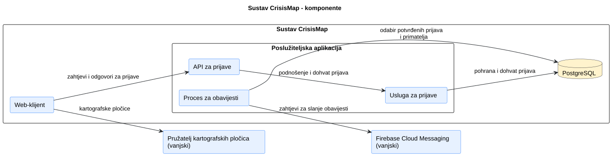
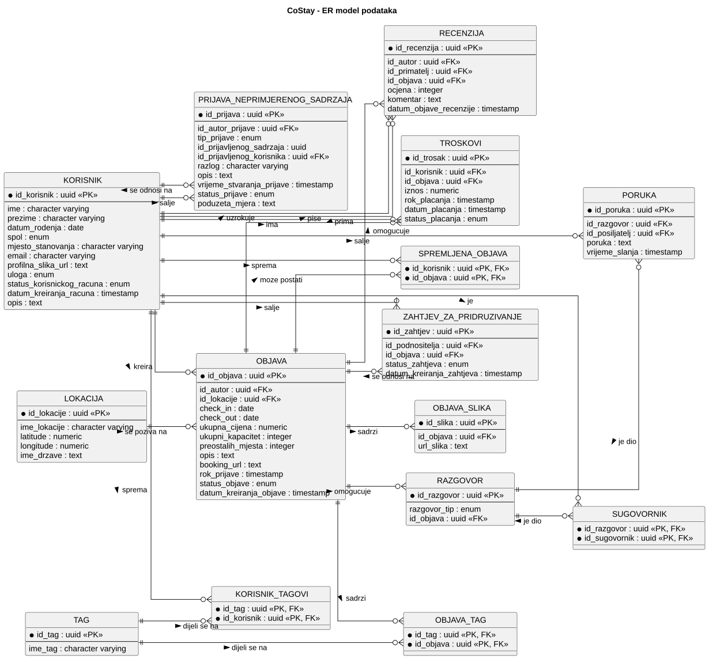
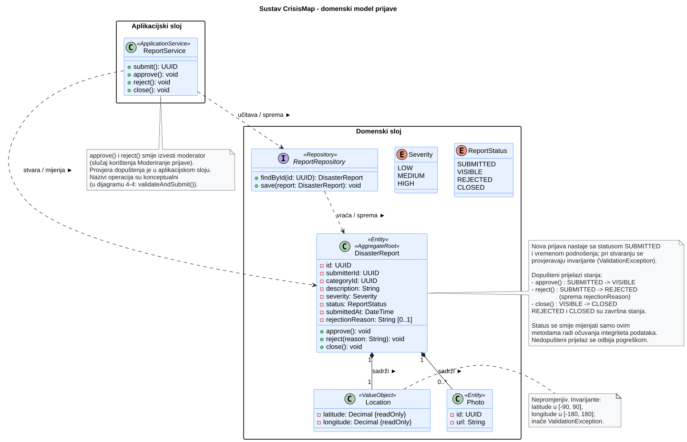
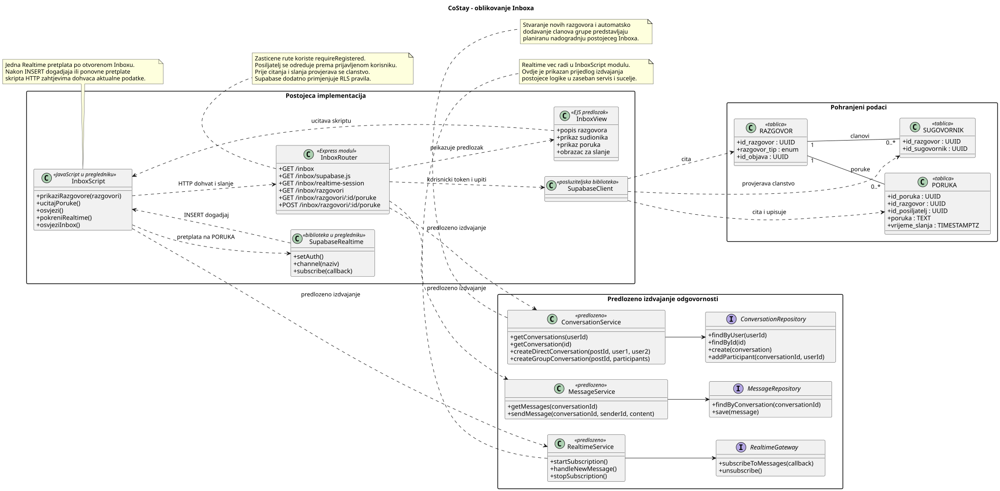
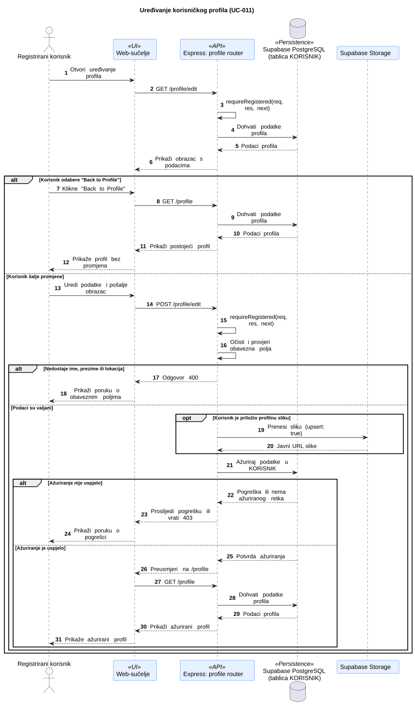
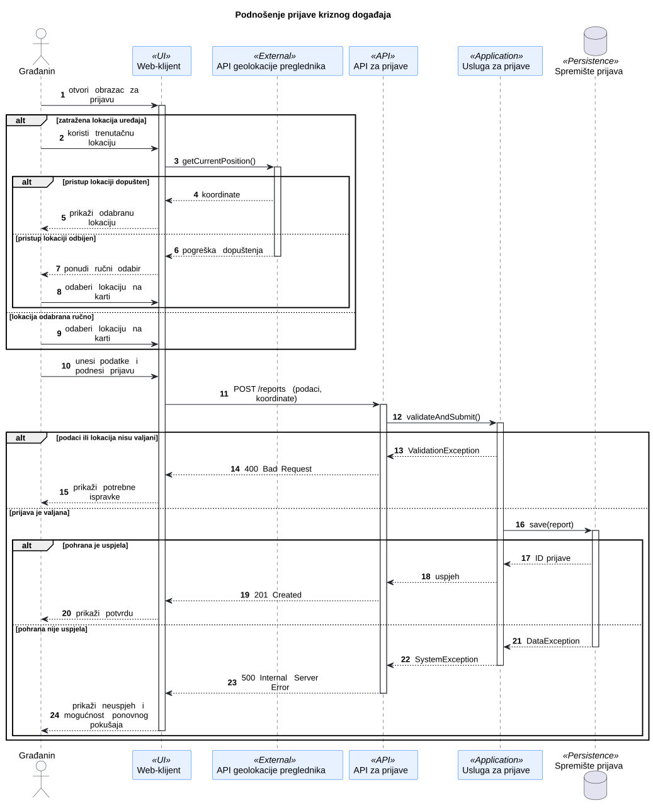

# 4. Arhitektura i oblikovanje

**Cilj:** Definirati arhitekturni stil, dekompoziciju programa na podsustave i module, organizaciju podataka te dinamičko ponašanje tijekom izvođenja. Arhitektura predstavlja temelj za implementaciju i ažurira se pri svakoj važnijoj promjeni projektnih odluka.

| Arhitekturni pogled      | Ključno inženjersko pitanje                           | Primijenjeni model ili dijagram    |
| :----------------------- | :---------------------------------------------------- | :--------------------------------- |
| **Strategija rješenja**  | Koji stil i temeljne odluke određuju program?         | Tablica odluka (odjeljak 4.1)      |
| **Struktura podsustava** | Koji su glavni dijelovi i kako komuniciraju?          | Dijagram komponenata               |
| **Model podataka**       | Kako su strukturirani trajni podaci programa?         | Relacijski ER dijagram             |
| **Struktura koda**       | Kako su dodijeljene odgovornosti i ključne klase?     | Reprezentativni dijagram razreda   |
| **Dinamičko ponašanje**  | Kako moduli surađuju pri obradi ključnih transakcija? | sekvencijski dijagram              |
| **Stanja sustava**       | Kako ključni domenski objekt mijenja svoja stanja?    | Dijagram stanja                    |
| **Fizički razmještaj**   | Na kojim se izvršnim čvorovima program izvodi?        | Dijagram razmještaja (poglavlje 6) |

---

Za svaki UML dijagram čuvajte čitljivu sliku i PlantUML izvor, kako je opisano na stranici [Home](./Home.md). U dovršenoj stranici koristite vlastite projektne odluke i modele.

## 4.1 Ključne arhitekturne odluke

**Cilj:** Objasniti nekoliko arhitekturnih odluka koje najviše utječu na rješenje i navesti njihove projektno specifične razloge.

| Odluka                                                                                                      | Razmatrana alternativa                                                                                         | Projektno specifično obrazloženje i kompromis                                                                                                                                                                                                                                                                                                                                                                       |
| ----------------------------------------------------------------------------------------------------------- | -------------------------------------------------------------------------------------------------------------- | ------------------------------------------------------------------------------------------------------------------------------------------------------------------------------------------------------------------------------------------------------------------------------------------------------------------------------------------------------------------------------------------------------------------- |
| Organizacija aplikacije kao jedinstvenog Express poslužitelja s odvojenim modulima prema funkcionalnostima. | Razdvajanje funkcionalnosti u više samostalnih poslužiteljskih usluga.                                         | CoStay obuhvaća međusobno povezane funkcionalnosti registracije, objavljivanja smještaja, pretraživanja, korisničkih profila i komunikacije. Organizacija unutar jedne aplikacije pojednostavljuje integraciju i razvoj, dok zasebni moduli omogućuju podjelu odgovornosti među članovima tima. Kompromis je međusobna ovisnost modula i potreba za zajedničkim postavljanjem cijelog poslužitelja. U produkciji se cijeli Express poslužitelj izvodi kao jedna web-usluga na Renderu.                 |
| Razdvajanje potvrđenog identiteta u Supabase Authu od dovršenog profila u tablici `KORISNIK`.               | Smatrati korisnika potpuno registriranim čim uspješno prođe vanjsku autentifikaciju.                           | Google i GitHub ne osiguravaju sve podatke koje CoStay zahtijeva. Autentifikacija zato potvrđuje identitet, dok aplikacija zasebno provjerava obavezni profil. Korisnik bez profila upućuje se na dovršavanje registracije. Kompromis je dodatna provjera i mogućnost postojanja Auth računa bez dovršenog CoStay profila.                                                                                          |
| Korištenje OAuth autorizacijskog toka s PKCE-om i razmjenom povratnog koda na backendu.                     | Prethodna implementacija koja je čitala tokene iz URL fragmenta u pregledniku i slala ih backendu.             | Podaci potrebni za dovršavanje PKCE toka privremeno se vežu uz Express sesiju koja je pokrenula prijavu. Backend razmjenjuje povratni kod za tokene. Time se uklanja prethodni prijenos tokena iz URL fragmenta putem frontend skripte. Kompromis je potreba očuvanja iste sesije tijekom preusmjeravanja.                                                                                                          |
| Zajednička provjera pristupa kroz middleware `requireRegistered`.                                           | Provjeravati samo postoji li `req.session.user` ili ponavljati različite provjere u svakoj ruti.               | Postojanje sesije nije dovoljno za pristup zaštićenim funkcionalnostima. Middleware provjerava identitet, potvrdu emaila, obavezni profil, ulogu i status računa te provjereni profil predaje sljedećem handleru kroz `req.korisnik`. Moduli aplikacije tako koriste jednaka pravila pristupa. Kompromis su dodatni pozivi Supabaseu pri zaštićenim zahtjevima.                                                     |
| Korištenje korisničkog Supabase klijenta i pravila sigurnosti na razini redaka (RLS).                       | Izvršavati sve operacije nad bazom preko privilegiranog poslužiteljskog pristupa uz ručnu provjeru dopuštenja. | CoStay pohranjuje osobne podatke, zahtjeve za pridruživanje i privatne razgovore. Korištenjem pristupnog tokena trenutačnog korisnika baza može primjenjivati RLS pravila prema njegovu identitetu. Time se dio kontrole pristupa provodi na razini baze, a ne samo aplikacijskih ruta. Kompromis je složenije definiranje i testiranje sigurnosnih pravila.                                                        |
| Obnova pristupnih tokena kroz zajednički middleware i servis `refreshTokens`.                               | Zahtijevati novu prijavu nakon svakog isteka pristupnog tokena.                                                | Obnovni token omogućuje nastavak valjane prijave bez ponovnog korisničkog unosa. Implementacija razlikuje nevaljanu sesiju od privremene nedostupnosti usluge. Obrada zahtjeva iste sesije koordinira se unutar jednog Node procesa; za više procesa bio bi potreban drukčiji način koordinacije.                                                                                                                   |
| Odvajanje obaveznih podataka profila od neobaveznog opisa i ključnih riječi.                                | Tražiti sve podatke prije dopuštanja pristupa registriranom korisniku.                                         | Obavezni podaci i punoljetnost provjeravaju se pri dovršavanju profila. Opis i interesi služe predstavljanju i personalizaciji, ali nisu uvjet registracije. Korisnik može preskočiti završni korak. Spremanje opisa i veza s ključnim riječima izvodi se odvojenim upitima, pa se mora obraditi djelomičan neuspjeh.                                                                                               |
| Prikaz preporučenih objava na temelju zajedničkih ključnih riječi korisnika i objava.                       | Prikazivati sve dostupne objave bez prilagodbe interesima korisnika.                                           | CoStay povezuje korisnike koji imaju slične interese za putovanja. Sustav uspoređuje ključne riječi spremljene uz korisnički profil s ključnim riječima objava i prikazuje odgovarajuće otvorene objave. Ostale objave dostupne su zasebno, uz dohvat u manjim skupinama. Kompromis je potreba za dodatnim upitima i mogućnost da korisnik bez odabranih interesa ne dobije personalizirane preporuke.              |
| Kombiniranje pretraživanja prema lokaciji i filtriranja rezultata na poslužitelju.                          | Izvršavati sve kriterije pretraživanja izravno u bazi podataka.                                                | CoStay omogućuje pretraživanje smještaja prema lokaciji, udaljenosti, datumima, cijeni, kapacitetu i ključnim riječima. Trenutačna implementacija dohvaća podatke iz Supabasea i primjenjuje kombinirane kriterije u Node.js aplikaciji, uključujući izračun geografske udaljenosti. Takvo rješenje pojednostavljuje razvoj različitih filtara, ali zahtijeva prijenos i obradu većeg broja zapisa na poslužitelju. |
| Odvajanje razgovora, poruka i članstva u razgovoru u relacijskom modelu podataka.                           | Pohranjivati poruke i popis sudionika unutar jednog zapisa razgovora.                                          | CoStay podržava komunikaciju između korisnika kroz izravne i grupne razgovore. Zasebne tablice `RAZGOVOR`, `PORUKA` i `SUGOVORNIK` omogućuju povezivanje više sudionika s razgovorom i neovisan dohvat poruka. Prije pristupa porukama provjerava se članstvo korisnika u razgovoru. Kompromis je veći broj povezanih upita i složenije definiranje RLS pravila.                                                    |
| Korištenje Supabase Realtimea za obavijesti o novim porukama. | Periodički dohvat poruka iz preglednika. | Preglednik preko WebSocketa prima `INSERT` događaje za tablicu `PORUKA`, uz primjenu postojećih RLS pravila. Nakon događaja HTTP zahtjevima dohvaća popis razgovora i poruke odabranog razgovora. Nova poruka šalje se HTTP zahtjevom Express poslužitelju. Kompromis je održavanje Realtime veze, korištenje valjanog pristupnog tokena i ponovni dohvat podataka nakon uspostave veze. |

## 4.2 Gradivni blokovi i UML dijagram komponenata

**Cilj:** Prikazati logičku podjelu programa na komponente, njihova sučelja i vanjske integracije. Dijagram komponenata prikazuje logičku organizaciju, dok dijagram razmještaja prikazuje fizičko izvođenje. Ovaj prikaz ažurirajte kako sustav poprima konačan oblik.

**Dijagram komponenata:** [Ugradite čitljiv UML dijagram komponenata.]  
**PlantUML izvor:** [Poveznica na odgovarajuću `.puml` datoteku.]

Autentifikacija je organizirana u module unutar iste Express aplikacije. Ti moduli nisu zasebno postavljene usluge. Supabase Auth predstavlja vanjsku uslugu autentifikacije, dok aplikacija zadržava odgovornost za provjeru dovršenosti profila i dopuštenja pristupa.

| Modul | Odgovornost |
| ----- | ----------- |

Započnite crtanjem granice oko predloženog sustava. Unutar nje prepoznajte dijelove s različitim odgovornostima; planiranu bazu podataka aplikacije smjestite unutar granice, a usluge trećih strana izvan nje. Važne veze označite podatkom ili uslugom koja njima prolazi. Logička komponenta može biti modul unutar jedne poslužiteljske aplikacije: zaseban pravokutnik ne znači zasebno postavljenu uslugu. Tijekom implementacije ažurirajte dijagram kada se promijene odgovornosti ili veze. U završnoj inačici čitatelj treba moći povezati njegove dijelove s kodom. Dijagram razmještaja odgovara na pitanje gdje se ti dijelovi stvarno izvode.

<strong>Granica sustava, odgovornosti i vanjske ovisnosti</strong>

**Primjer — CrisisMap:** Predložena arhitektura podržava podnošenje prijava kriznih događaja, prikaz na karti i obavijesti o potvrđenim prijavama.

**Slika 4.1. Dijagram komponenata sustava CrisisMap**

**PlantUML izvor:** [izvor](./puml/4-1-crisismap-system-CMP.puml)

| Dio                  | Odgovornost                                                                                     | Razlog za ovu granicu                                                          |
| -------------------- | ----------------------------------------------------------------------------------------------- | ------------------------------------------------------------------------------ |
| Web-klijent          | Prikazuje prijave i prikuplja podatke za novu prijavu.                                          | Korisnička interakcija odvojena je od pravila prijave i trajne pohrane.        |
| API za prijave       | Prihvaća zahtjeve za rad s prijavama i vraća odgovore.                                          | Odgovornosti izložene putem HTTP-a odvojene su od obrade prijava.              |
| Usluga za prijave    | Primjenjuje pravila prijave i pristupa pohranjenim prijavama.                                   | Pravila provjere valjanosti i pohrane prijava imaju jasno mjesto odgovornosti. |
| Proces za obavijesti | Određuje korisnike koji trebaju primiti obavijest i traži od vanjskog pružatelja da je pošalje. | Obrada obavijesti odvojena je od odgovaranja na korisnikov zahtjev za prijavu. |

**Analiza primjera:** Vanjska granica odvaja predloženi sustav od pružatelja kartografskih usluga i pružatelja obavijesti. Unutarnja granica grupira API za prijave, uslugu za prijave i proces za obavijesti unutar jedne poslužiteljske aplikacije; njihovi zasebni simboli prikazuju predložene odgovornosti, a ne neovisno postavljene usluge. PostgreSQL pohranjuje podatke aplikacije, dok pružatelj kartografskih usluga osigurava kartografske pločice. Strelice sažimaju ovisnosti, a ne redoslijed transakcije; taj redoslijed prikazuje sekvencijski dijagram. Izostavite proces za obavijesti i Firebase Cloud Messaging ako obavijesti nisu dio odobrenog opsega. Pružatelja prijave u sustav uključite samo ako to zahtijeva odobreni zadatak. Kako implementacija napreduje, ispravite svaku predloženu granicu koja se pokaže netočnom; završni dijagram mora odgovarati onome što je tim izgradio. Jedan koherentan prikaz komponenata korisniji je od nekoliko gotovo jednakih inačica s proturječnim vezama.

## 4.3 Model podataka i oblikovanje razreda

**Cilj:** Objasniti važne informacije koje aplikacija pohranjuje i jedno reprezentativno područje oblikovanja na razini razreda. Model podataka i UML dijagram razreda odgovaraju na različita pitanja; jedno ne zamjenjuje drugo.

### 4.3.1 ER dijagram i model podataka

**Cilj:** Prikazati važne pohranjene entitete, njihove identifikatore i veze te dovoljno atributa za razumijevanje podataka aplikacije. ER dijagram odvojen je od reprezentativnog UML dijagrama razreda u nastavku.

**ER dijagram:** [ER dijagram](./assets/diagrams/4-3-1-costay-data-ERD.svg)
**Izvor dijagrama:** [puml](./puml/4-3-1-costay-data-ERD.puml)  
**Implementacija:** [sql](../supabase/migrations/20261109185243_create_costay_database.sql)

<strong>Stvaranje objave te podaci i veze </strong>

**Slika 4.2. ER dijagram podataka sustava CoStay**

**PlantUML izvor:** [izvor](./puml/4-3-1-costay-data-ERD.puml)

**Pregled entiteta CoStay baze podataka:**
Središnji entitet OBJAVA povezuje autora (KORISNIK) i lokaciju putovanja (LOKACIJA). Uz njega su vezani zahtjevi za pridruživanje,
fotografije, tagovi, recenzije, troškovi i razgovori. Posredne tablice KORISNIK_TAGOVI, OBJAVA_TAG, SPREMLJENA_OBJAVA i SUGOVORNIK
modeliraju veze više-na-više.

| Element               | Opis                                                                                                         |
| :-------------------- | :----------------------------------------------------------------------------------------------------------- |
| Korisnici i interesi  | KORISNIK, TAG, KORISNIK_TAGOVI; status korisničkog profila, uloga, drugi statusi i interesi                  |
| Objave i lokacije     | OBJAVA, LOKACIJA, OBJAVA_SLIKA, OBJAVA_TAG, SPREMLJENA_OBJAVA; detalji puta, fotografije i spremljene objave |
| Dogovaranje           | ZAHTJEV_ZA_PRIDRUZIVANJE; podnositelj, objava, status                                                        |
| Komunikacija          | RAZGOVOR, PORUKA, SUGOVORNIK; izravni/grupni razgovori i članstvo                                            |
| Povjerenje i troškovi | RECENZIJA, PRIJAVA_NEPRIMJERENOG_SADRZAJA, TROSKOVI                                                          |

**Primjer podataka i veza:** Ana kreira objavu na lokaciji `Opatija`. `OBJAVA.id_autor` upućuje na Anin korisnički identifikator, a `OBJAVA.id_lokacije` na odabranu lokaciju. Objava je u stanju `otvorena`. Bob šalje zahtjev u tablicu `ZAHTJEV_ZA_PRIDRUZIVANJE`, koji dobiva status `na_cekanju`. Potvrđene sudionike čine autor i korisnici s prihvaćenim zahtjevima. Nakon prihvaćanja Bobova zahtjeva to su Ana i Bob. Ako Ana prihvati i Charlieja, konačni popis uključuje sve troje. Model predviđa da se nakon prelaska objave u stanje `dogovorena` stvori grupni razgovor za autora i konačno potvrđene sudionike. Automatsko stvaranje grupe je planirano, a postojeći Inbox omogućuje razmjenu poruka u već formiranim izravnim i grupnim razgovorima. Model troškova predviđa raspodjelu ukupne cijene smještaja među konačno potvrđenim sudionicima.

**Povezanost autentifikacijskog identiteta i korisničkog profila**
Supabase Auth upravlja autentifikacijskim identitetom, dok tablica `KORISNIK` sadrži aplikacijski profil. Backend pri stvaranju profila postavlja `id_korisnik` na identifikator potvrđenog Auth korisnika. Time aplikacija povezuje identitet i pripadajuće podatke profila.

Ključne riječi pohranjene su u tablici `TAG`, a veze korisnika s ključnim riječima u tablici `KORISNIK_TAGOVI`. Neobavezni opis pohranjuje se u profilu korisnika.

Lozinka se ne pohranjuje u tablicu `KORISNIK` niti u Express sesiju. Obradu vjerodajnica provodi Supabase Auth.

### 4.3.2 Reprezentativni UML dijagram razreda

**Cilj:** Prije implementacije reprezentativnog dijela sustava modelirati i prikazati razrede ili sučelja potrebna za dodjelu odgovornosti, operacija i veza. Oblikovanje ažurirajte kada se te odluke promijene.

**Dijagram razreda:** [Ugradite čitljiv UML dijagram razreda za reprezentativni dio oblikovanja.]  
**PlantUML izvor:** [Poveznica na odgovarajuću `.puml` datoteku.]  
**Referenca na kod pri završnom pregledu:** [Poveznica na odgovarajuću implementaciju.]

<strong>Oblikovanje odgovornosti prijave i dopuštenih promjena</strong>

**Primjer — CrisisMap:** Prijava sadrži pravila za promjenu vlastitog statusa. Razred tijeka rada koordinira podnošenje i pregled, dok sučelje repozitorija opisuje potrebne operacije trajne pohrane. Dijagram predlaže te odgovornosti prije implementacije.

**Slika 4.3. Dijagram razreda za obradu prijava kriznih događaja**

**PlantUML izvor:** [izvor](./puml/4-3-crisismap-domain-CD.puml)

**Analiza primjera:** `DisasterReport` sadrži dopuštena pravila promjene stanja pa tijek rada ne može prešutno odobriti već odbijenu prijavu. `ReportWorkflow` koordinira operaciju bez preuzimanja pravila prijelaza stanja same prijave; `ReportRepository` definira potrebne operacije pohrane. Kompozicija `Location` i odabrani tipovi prikazuju veze korisne za oblikovanje. Dijagram namjerno izostavlja stupce baze podataka i nepovezane razrede: ER model objašnjava pohranjene podatke, dok ovaj dijagram dodjeljuje programske odgovornosti i operacije. Ti su razredi odluka oblikovanja, a ne obavezni slojevi za svaki tim. Završnu implementaciju usporedite s početnim oblikovanjem i ažurirajte dijagram tamo gdje su se odluke promijenile; generiranje dijagrama iz koda tek na kraju ne može zamijeniti ovo početno modeliranje.

**Cilj:** Modelirati odgovornosti i međusobne odnose komponenti potrebnih za prikaz razgovora, dohvat i slanje poruka te komunikaciju u stvarnom vremenu unutar funkcionalnosti Inbox.

**Dijagram razreda:**

**Slika 4.3.2. Dijagram razreda za Inbox sustava CoStay**

**PlantUML izvor:** [Izvor dijagrama Inboxa](./puml/4-3-2-inbox-class-diagram.puml)

**Referenca na postojeću implementaciju:**

- [Express rute Inboxa](../backend/src/routes/inbox.js)
- [EJS predložak Inboxa](../frontend/src/pages/inbox.ejs)
- [Skripta Inboxa i Realtime pretplata](../frontend/src/services/inbox.js)

**Analiza oblikovanja:**

Dijagram prikazuje postojeću implementaciju Inbox funkcionalnosti i predloženo oblikovanje njezinih odgovornosti. Postojeći Express modul `InboxRouter` obrađuje HTTP zahtjeve za prikaz stranice Inbox, dohvat razgovora, dohvat poruka i slanje novih poruka. Pristup podacima ostvaruje se korištenjem Supabase klijenta. Predložak `InboxView` definira korisničko sučelje koje sadrži popis razgovora, prikaz poruka i obrazac za slanje poruka.

U trenutačnoj implementaciji obrada zahtjeva i komunikacija s bazom nalaze se unutar istog modula. Predloženo oblikovanje zato uvodi `ConversationService` i `MessageService`, kojima se odvajaju poslovna logika razgovora i obrada poruka. Sučelja `ConversationRepository` i `MessageRepository` definiraju operacije potrebne za dohvat razgovora, sudionika i poruka te pohranu novih poruka.

Skripta Inboxa u pregledniku dohvaća korisnikov pristupni token preko zaštićene rute `/inbox/realtime-session` i otvara jednu Supabase Realtime pretplatu dok je Inbox otvoren. Pretplata sluša `INSERT` događaje na tablici `PORUKA`. Nakon događaja preglednik ponovno dohvaća popis razgovora i poruke odabranog razgovora. Korisnik novu poruku šalje HTTP zahtjevom Express poslužitelju, koji provjerava članstvo i sprema poruku u Supabase.

Model pohranjenih podataka prikazuje tablice `RAZGOVOR`, `SUGOVORNIK` i `PORUKA`. Jedan razgovor može imati više zapisa članstva i više poruka. Svaka poruka pripada jednom razgovoru i povezana je s pošiljateljem preko korisničkog identifikatora.

**Razlika između oblikovanja i implementacije:** Postojeća implementacija prikazana je kroz Express modul `InboxRouter`, EJS predložak `InboxView`, preglednički modul `InboxScript` i korištenje Supabase biblioteke. Nazivi na dijagramu označavaju odgovornosti tih modula. `ConversationService`, `MessageService`, `RealtimeService` i pripadajuća sučelja predstavljaju prijedlog budućeg izdvajanja odgovornosti. Realtime komunikacija već je implementirana unutar pregledničke skripte Inboxa. Automatsko stvaranje razgovora ostaje planirana nadogradnja.

## 4.4 Ponašanje tijekom izvođenja

**Cilj:** Objasniti jednu važnu interakciju među dijelovima koji se izvode i životni ciklus jednog smislenog objekta. Odaberite primjere koji otkrivaju odluke ili neuspješne putove umjesto izrade dijagrama za svaku CRUD radnju.

### 4.4.1 Reprezentativni UML sekvencijski dijagram

**Cilj:** Prikazati redoslijed poruka za jedan reprezentativni scenarij i odgovore na važnu alternativu.

**Scenarij:** Uređivanje korisničkog profila (UC-011). Prijavljeni korisnik već je na svom profilu i odabire uređivanje. Može se vratiti bez spremanja ili poslati promjene. 

**Sekvencijski dijagram:** 
 
**Slika 4.4.1. Sekvencijski dijagram uređivanja korisničkog profila**

**PlantUML izvor:** [Izvor sekvencijskog dijagrama](./puml/4-4-costay-edit-profile-SD.puml)

<strong>Odabir lokacije, provjera valjanosti i podnošenje prijave</strong>

**Primjer — CrisisMap:** Građanin podnosi prijavu kriznog događaja nakon što ručno odabere lokaciju ili zatraži položaj uređaja. Interakcija prikazuje i što se događa kada je pristup lokaciji odbijen, podaci prijave nisu valjani ili pohrana ne uspije.

**Slika 4.4. Sekvencijski dijagram podnošenja prijave kriznog događaja**

**PlantUML izvor:** [izvor](./puml/4-4-crisismap-report-submission-SD.puml)

**Analiza primjera:** Dva načina odabira lokacije te alternative provjere i pohrane imaju različite posljedice za korisnika; usporedite ih s odgovarajućim obrascem uporabe i njegovim alternativnim tijekovima. API preglednika za lokaciju mogućnost je preglednika; web-klijent, API, usluga i pohrana odgovaraju prikazu komponenata. Odaberite grane koje pomažu objasniti scenarij vašeg projekta i završni dijagram uskladite s implementiranom interakcijom.

### 4.4.2 Reprezentativni UML dijagram stanja

**Cilj:** Prikazati važna stanja jednog domenskog objekta ili eksplicitno upravljanog načina rada sustava te događaje ili uvjete koji ih mijenjaju.

**Vlasnik stanja i razlog odabira:** [Navedite objekt ili način rada sustava, kako se njegovo stanje prepoznaje i zašto su prijelazi važni.]  
**Dijagram stanja:** [Ugradite čitljiv UML dijagram stanja.]  
**PlantUML izvor:** [Poveznica na odgovarajuću `.puml` datoteku.]

<strong>Složeno stanje sustava: koordinacija događaja i dostupnost usluge</strong>

**Primjer — CrisisMap:** Ovaj primjer ne prikazuje životni ciklus jednog domenskog objekta, nego dva neovisna aspekta stanja cijelog sustava CrisisMap. Jedna regija opisuje način koordinacije kriznog događaja, a druga opaženu dostupnost usluge. Budući da se ta dva aspekta mogu mijenjati neovisno jedan o drugome, prikazani su kao ortogonalne regije istog složenog stanja sustava.

**Slika 4.5. Dijagram stanja sustava s ortogonalnim regijama**

**PlantUML izvor:** [izvor](./puml/4-5-crisismap-system-SM.puml)

**Analiza primjera:** Vlasnik stanja u ovom je primjeru sustav CrisisMap, a ne pojedinačna prijava kriznog događaja. Dvije ortogonalne regije opisuju stanja koja vrijede istodobno: način koordinacije kriznog događaja i dostupnost usluge. Promjena stanja u jednoj regiji ne mora promijeniti stanje u drugoj; primjerice, aktivni krizni događaj može postojati dok je usluga potpuno ili djelomično dostupna.

Prijelazi imaju imenovane događaje ili uvjete, a grane nakon oporavka poslužiteljskog sustava uzimaju u obzir da pružatelj kartografskih usluga može i dalje biti nedostupan. Time primjer pokazuje situaciju u kojoj ortogonalne regije imaju stvarnu semantičku svrhu, a nisu samo način vizualnog grupiranja elemenata.

Ovo je napredniji primjer dijagrama stanja. Koristite takav oblik samo ako sustav stvarno održava dva ili više međusobno neovisnih aspekata stanja koji se mogu mijenjati istodobno. Za projekt u kojem je važan životni ciklus jednog objekta, primjerice prijave, rezervacije ili narudžbe, jednostavniji dijagram stanja tog objekta obično je prikladniji. Složenost dijagrama nije kriterij vrednovanja.

Pri završnom pregledu svaki prikazani prijelaz i uvjet usporedite s ponašanjem koje implementirana aplikacija stvarno podržava.

## 4.5 Zapisi arhitekturnih odluka

**Cilj:** Sačuvati razloge i obrazložiti odabrane važne arhitekturne odluke kada tablica u odjelku 4.1 nije dovoljna za očuvanje konteksta, razmatranih alternativa i prihvaćenih kompromisa.

Napišite nekoliko ADR-a za važne odluke čije obrazloženje, alternative i kompromis treba sačuvati. Ostale arhitekturne odluke dovoljno je zabilježiti u tablici.

**Detaljni zapis arhitekturne odluke (engl. Architecture Decision Record, ADR), kada odluka zahtijeva dodatno objašnjenje:**

### ADR-[ID]: [Naslov odluke]

| Polje                  | Zapis odluke                                                                            |
| ---------------------- | --------------------------------------------------------------------------------------- |
| Kontekst i cilj        | [Koji je arhitekturni problem učinio ovu odluku potrebnom?]                             |
| Kriteriji odluke       | [Što je timu stvarno bilo važno?]                                                       |
| Razmatrane alternative | [Realne mogućnosti koje je tim razmotrio, ukratko.]                                     |
| Odluka i obrazloženje  | [Odabrana mogućnost, zašto je odabrana i čega se tim odrekao.]                          |
| Status                 | [Predloženo, prihvaćeno ili zamijenjeno; ako je primjenjivo, poveznica na novu odluku.] |

ADR pišite samo za odluku čije će obrazloženje ostati važno i nakon promjene implementacije. Značajna promjena odluke može se zabilježiti novim ADR-om koji zamjenjuje stari; rutinski odabiri alata ne trebaju detaljne zapise. Promjene dogovorenog opsega pripadaju zahtjevima i njihovoj povijesti promjena; povratna informacija o zadatku ostaje uz odgovarajući zadatak.

<strong>Odabir jednog poslužiteljskog sustava umjesto zasebno postavljenih usluga</strong>

**Primjer — CrisisMap, ADR-01:**

| ID     | Datum          | Odluka                                     | Razmatrana alternativa                          | Obrazloženje i kompromis                                                                                                      | Status     |
| ------ | -------------- | ------------------------------------------ | ----------------------------------------------- | ----------------------------------------------------------------------------------------------------------------------------- | ---------- |
| ADR-01 | [Datum odluke] | Jedan poslužiteljski API za obradu prijava | Zasebno postavljene usluge za prijave i resurse | Manji napor postavljanja i integracije za odobreni opseg; kvar poslužiteljskog sustava može utjecati na obje funkcionalnosti. | Prihvaćeno |

### ADR-01: Jedan poslužiteljski API za obradu prijava

| Polje                  | Zapis odluke                                                                                                                                                                                                   |
| ---------------------- | -------------------------------------------------------------------------------------------------------------------------------------------------------------------------------------------------------------- |
| Kontekst i cilj        | Tim tijekom jednog semestra mora izraditi i javno postaviti prijavljivanje kriznih događaja i prikaz usmjeren na kartu.                                                                                        |
| Kriteriji odluke       | Tim može izraditi, integrirati, postaviti i objasniti rješenje; komponente i dalje imaju prepoznatljive odgovornosti.                                                                                          |
| Razmatrane alternative | **Jedan poslužiteljski sustav:** moduli dijele aplikaciju koja se postavlja kao cjelina. **Zasebne usluge:** svaka se može izvoditi neovisno, ali zahtijeva dodatni rad na integraciji i postavljanju.         |
| Odluka i obrazloženje  | Odabrati jedan poslužiteljski sustav s jasno odvojenim odgovornostima vezanim uz prijave. Time se smanjuje rad na postavljanju, uz prihvaćanje da kvar tog sustava može istodobno utjecati na rad s prijavama. |
| Status                 | Prihvaćeno.                                                                                                                                                                                                    |

**Analiza primjera:** Strategija rješenja navodi trenutačni pristup; ADR-01 čuva alternative i kriterije koji su do njega doveli. Dijagrami komponenata i razmještaja trebaju odražavati odabrani pristup kako se sustav razvija. Zaseban ADR koristan je za važnu odluku, a ne za svaki odabir alata.

## 4.6 Zajednička pravila oblikovanja (engl. Cross-cutting concerns)

**Cilj:** Prepoznati i opisati globalna pravila i mehanizme oblikovanja koji se primjenjujuju u više dijelova aplikacije, navesti gdje se planira primijeniti i ažurirati objašnjenje kako implementacija poprima konačan oblik. Uključite samo pravila koja su važna za ovaj projekt.

**Implementirani mehanizmi:**
| Aspekt | Mehanizam | Pravilo | Mjesto primjene |
| --- | --- | --- | --- |
| Autorizacija | `requireRegistered` | Uvjeti pristupa provjeravaju se na backendu prije zaštićene radnje. Skrivanje elemenata sučelja nije zamjena za provjeru ovlasti. | Zaštićene Express rute. |
| Pristup podacima | Korisnički Supabase klijent i RLS | Upiti se šalju s tokenom korisnika. Identifikator vlasnika pri stvaranju vlastitih podataka određuje backend iz provjerenog konteksta. | Rute koje čitaju ili mijenjaju korisničke podatke. |
| Validacija | Poslužiteljska provjera unosa | Obavezna polja, datum rođenja, punoljetnost i odabrane ključne riječi provjeravaju se prije pohrane. | Obrada registracije i dopune profila. |
| Upravljanje sesijom | Regeneracija sesije, obnova tokena i odjava | Nakon uspješne prijave uspostavlja se nova Express sesija. Tokeni se obnavljaju kada je potrebno, a odjavom se uklanja trenutačna sesija aplikacije. | Kontroler autentifikacije, middleware obnove i ruta odjave. |
| Obrada pogrešaka | Provjera rezultata Supabase poziva | Neuspješan upit ne prikazuje se kao uspješna radnja. Privremena nedostupnost autentifikacije razlikuje se od nevaljane prijave. | Kontroleri, middleware i registracijske rute. |
| Oporavak lozinke | Privremeni kontekst oporavka i provjera obrasca | Obična prijava nije dovoljna za izvršavanje tijeka oporavka. Promjena zahtijeva valjan kontekst oporavka i provjeru poslanog obrasca. | Povratna ruta oporavka i ruta za postavljanje nove lozinke. | |

<strong>Primjer zajedničkih pravila i mehanizama</strong>

**Primjer — CrisisMap:**

| Aspekt                  | Mehanizam                        | Pravilo                                                                                                                                                            | Mjesto primjene                                                                         |
| ----------------------- | -------------------------------- | ------------------------------------------------------------------------------------------------------------------------------------------------------------------ | --------------------------------------------------------------------------------------- |
| Sigurnost               | Autorizacija moderiranja prijava | Ovlasti moderatora provjeravaju se na poslužiteljskoj strani prije odobravanja ili odbijanja prijave; skrivanje gumba u korisničkom sučelju nije dovoljna zaštita. | Poslužiteljski dio funkcionalnosti za moderiranje prijava.                              |
| Validacija podataka     | Provjera lokacije prijave        | Nedostajuće ili nevaljane koordinate odbijaju se prije pohrane prijave.                                                                                            | Obrada podnošenja prijave.                                                              |
| Aspekt                  | Mehanizam                        | Pravilo                                                                                                                                                            | Mjesto primjene                                                                         |
| Upravljanje ovisnostima | Injektiranje ovisnosti           | Objekt koji provodi poslovnu logiku ne stvara sam konkretnu implementaciju repozitorija, nego potrebnu ovisnost prima izvana.                                      | `ReportWorkflow` prima implementaciju sučelja `ReportRepository` pri stvaranju objekta. |

**Analiza primjera:** Prvi redak pokazuje sigurnosno pravilo koje se provodi neovisno o korisničkom sučelju, a drugi pravilo provjere podataka prije pohrane. U vlastitoj dokumentaciji navedite samo aspekte koji se stvarno primjenjuju u projektu te konkretno mjesto njihove primjene.

Obrasci poput injektiranja ovisnosti (engl. Dependency Injection) ili repozitorija (engl. Repository) pripadaju ovdje samo kada ih kod stvarno koristi i kada objašnjavaju zajedničko pravilo oblikovanja. Tvrdnja „sustav koristi autentikaciju” sama po sebi ne govori čitatelju gdje se provjera provodi niti što štiti. Sigurnost, bilježenje događaja i obrada pogrešaka ne trebaju svaki zaseban pododjeljak po zadanom pravilu.

## 4.7 Arhitekturni rizici i tehnički dug

**Cilj:** Navesti stvarne tehničke ili domenske rizike i svjesno prihvaćene kompromise oblikovanja, njihove posljedice i način na koji ih tim obrađuje.

**Tehnički rizici i dug**

| Rizik ili kompromis                        | Posljedica                                                                   | Odgovor na rizik                                                                         |
| ------------------------------------------ | ---------------------------------------------------------------------------- | ---------------------------------------------------------------------------------------- |
| _Npr. Pohrana slika u lokalni file sustav_ | _Pri ponovnom pokretanju kontejnera slike će biti izgubljene._               | _Prihvaćeni tehnički dug za demo verziju. U budućnosti planirana migracija na S3 (AWS)._ |
| _Npr. Nepostojanje paginacije na API-ju_   | _Moguće usporenje klijenta pri dohvaćanju velike količine podataka iz baze._ | _Ograničen broj testnih unosa. Dodavanje paginacije ostavljeno za sljedeću iteraciju._   |
|                                            |                                                                              |                                                                                          |

**Poslovni ili domenski rizici, ako su značajni**

| Rizik                                          | Posljedica                                                                            | Odgovor na rizik                                                                                                                    |
| ---------------------------------------------- | ------------------------------------------------------------------------------------- | ----------------------------------------------------------------------------------------------------------------------------------- |
| **Jedna instanca aplikacije obrađuje prijave** | Kvar poslužitelja (hostinga) privremeno onemogućuje nove prijave.                     | Prihvaćeno u okviru ograničenja projekta za kolegij; tim ne tvrdi da postoji automatsko prebacivanje na pričuvni sustav (failover). |
| **Nedostupnost vanjskke kartografske usluge**  | Prikaz karte može prestati raditi iako su pohranjene prijave u bazi i dalje dostupne. | Implementirana je korisniku vidljiva poruka o pogrešci uz alternativu pregleda prijava u tekstualnom obliku.                        |
|                                                |                                                                                       |                                                                                                                                     |

<strong>Primjer tehničkih i domenskih rizika</strong>

**Primjer — CrisisMap, tehnički rizici:**

| Rizik ili kompromis                                    | Posljedica                                                                     | Odgovor na rizik                                                                                |
| ------------------------------------------------------ | ------------------------------------------------------------------------------ | ----------------------------------------------------------------------------------------------- | --------------------------------------------------------------------------------------------------- |
| Jedna instanca aplikacije obrađuje podnošenje prijava. | Kvar smještaja aplikacije privremeno onemogućuje nove prijave.                 | Rizik je prihvaćen za opseg projekta; ne uvodi se pričuvna instanca ni automatsko prebacivanje. |
| Vanjske kartografske usluge nisu dostupne.             | Prikaz karte može prestati raditi iako su pohranjene prijave i dalje dostupne. | Karta se ne može prikazati, ali pohranjene prijave ostaju dostupne.                             | Aplikacija prikazuje poruku o nedostupnosti karte i omogućuje pregled prijava u tekstualnom obliku. |

**Primjer — CrisisMap, domenski rizik:** Čitatelji mogu neprovjerenu prijavu građanina zamijeniti za službeno upozorenje. Tim može u sučelju jasno razlikovati status provjere prijave i uputiti korisnike na službene izvore.

**Analiza primjera:** Prvi tehnički rizik prihvaća realistično ograničenje projekta kolegija; domenski se rizik odnosi na način na koji čitatelj tumači prijavu. Zabilježite ograničenje i realan odgovor koji pripadaju vašem projektu. Neostvarena obavezna funkcionalnost nije tehnički dug nego nedovršen opseg.

---

> **Završna provjera:** Usporedite dijagrame komponenata, podataka, razreda, sekvencijski dijagram i dijagram stanja s implementiranim kodom, ponašanjem aplikacije i stvarnim razmještajem. Ažurirajte zastarjele opise oblikovanja i objasnite svaku važnu razliku koja ostaje; poveznice na odgovarajući kod ili ispitivanja korisne su kada odgovaraju na konkretno pitanje.
