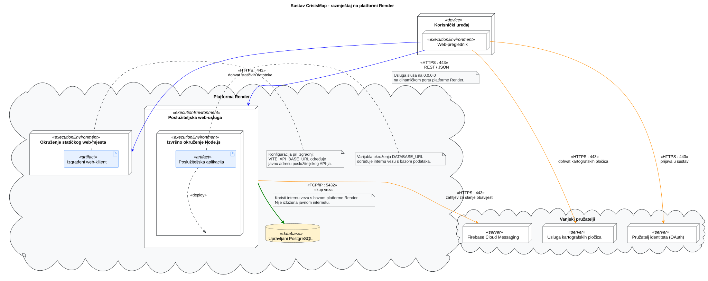

# 6. Postavljanje, instalacija i konfiguracija

**Cilj:** Detaljno dokumentirati topologiju izvođenja, postupak lokalne instalacije i konfiguracije iz izvornog koda te način javnog postavljanja i administracije programa. [README](../README.md) navodi javnu adresu i sažeti postupak lokalnog pokretanja; ova stranica donosi potpun inženjerski postupak koji osigurava točnu ponovljivost na drugom računalu.

Zamijenite oglednu topologiju, naredbe i postavke onima koje vaš tim stvarno koristi (u primjeru se koristi Render; dokumentirajte platformu odabranu za vaš projekt).

---

## 6.1 Prikaz razmještaja

**Cilj:** Prikazati okruženja izvođenja, raspodijeljene dijelove programa, spremište podataka i relevantne vanjske usluge. Njihovu komunikaciju i mrežne protokole prikažite jednim UML dijagramom razmještaja. Dok dijagram komponenata iz Poglavlja 4 prikazuje logičke odgovornosti, dijagram razmještaja pokazuje gdje se izvršni artefakti fizički ili virtualno izvode.

**Dijagram razmještaja:** [Ugradite čitljivu sliku UML dijagrama razmještaja.]  
**PlantUML izvor:** [Poveznica na odgovarajuću `.puml` datoteku.]  
**Javno dostupna aplikacija:** [Poveznica na javnu adresu navedenu u README-u ili na njegov odjeljak o postavljanju.]

*Pravila izrade prikaza:*
* Označite stvarne čvorove na kojima se program izvodi (korisnički uređaj, poslužitelj, baza podataka) i protokole među njima.
* Bazu podataka ili vanjskog pružatelja usluga uključite samo ako ih postavljeni program stvarno koristi.
* Razvojno računalo nije javni poslužitelj; prikažite isključivo produkcijsko okruženje.
* Ako se planirana arhitektura tijekom implementacije promijenila, ovdje prikažite stvarni razmještaj i odgovarajuće ažurirajte opis arhitekture.

<details>
<summary><strong>Primjer: Javno postavljanje programa za prijave i obavijesti </strong></summary>

**Primjer — CrisisMap:**
Predloženi klijentski dio gradi se kao statičko web-mjesto. Poslužiteljska web-usluga obrađuje prijave i asinkrono šalje obavijesti unutar **iste postavljene poslužiteljske aplikacije**. PostgreSQL sprema podatke prijava, pružatelj kartografskih usluga isporučuje kartografske pločice pregledniku, a Firebase Cloud Messaging prima zahtjeve za slanje upozorenja iz poslužiteljskog dijela. Primjer pretpostavlja da obavijesti pripadaju opsegu tog konkretnog projekta.



**Slika 6.1. UML dijagram razmještaja sustava CrisisMap**

**PlantUML izvor:** [izvor](./puml/6-1-crisismap-DD.puml)
**Analiza razmještaja:**
* **Korisnički uređaj:** Web-preglednik izvršava klijentski kod nakon preuzimanja statičkih datoteka.
* **Poslužiteljski čvor:** Poslužiteljski API i pozadinski zadaci nalaze se unutar jedne usluge (jednog izvršnog procesa).
* **Baza podataka:** Veza s bazom uspostavlja se isključivo iz poslužiteljskog dijela putem interne mreže, a nikada izravno iz klijentskog preglednika.
* **Vanjske usluge:** Pružatelj kartografskih usluga i pružatelj obavijesti nalaze se izvan infrastrukture koju postavlja tim.
</details>

---

## 6.2 Lokalna instalacija i konfiguracija

**Cilj:** Omogućiti novom članu tima ili ocjenjivaču da preuzme izvorni kod aplikacije CoStay, instalira potrebne ovisnosti, konfigurira pristup bazi podataka i lokalno pokrene aplikaciju te provjeri ispravnost komunikacije između korisničkog sučelja, poslužitelja i baze podataka.

### 1. Preduvjeti i preuzimanje izvornog koda

CoStay je web-aplikacija razvijena pomoću Node.js okruženja i radnog okvira Express. Korisničko sučelje izrađeno je tehnologijama HTML, CSS, JavaScript i EJS. Za pohranu podataka, autentifikaciju i komunikaciju u stvarnom vremenu koristi se Supabase, koji se temelji na PostgreSQL bazi podataka.

Za lokalno pokretanje aplikacije potrebni su:

- **Node.js v24.16.0** – inačica korištena tijekom razvoja projekta.
- **npm** – upravitelj paketa koji dolazi uz Node.js.
- **Git** – za preuzimanje i ažuriranje izvornog koda.
- **Supabase projekt** – razvojni projekt s pripremljenom bazom podataka, pravilima pristupa i konfiguriranom autentifikacijom.

U standardnom razvojnom postupku CoStay koristi udaljenu bazu podataka na Supabase platformi, zbog čega nije potrebno zasebno instalirati PostgreSQL na razvojno računalo.

Izvorni kod preuzima se iz javnog GitHub repozitorija. U terminalu, iz direktorija u koji se želi preuzeti projekt, izvršavaju se naredbe:

```bash
git clone https://github.com/MarkoZvonar/CoStay-Project.git
cd CoStay-Project
```

Nakon preuzimanja repozitorija dobiva se struktura koja uključuje:

- `backend/` – poslužiteljski dio aplikacije, Express rute, kontrolere, middleware i konfiguraciju.
- `frontend/` – EJS stranice, CSS, JavaScript i ostale datoteke korisničkog sučelja.
- `docs/` – projektna dokumentacija.
- `supabase/` – konfiguraciju Supabase okruženja.
- `db/` – projektne datoteke povezane s bazom podataka.

### 2. Instalacija ovisnosti

Za instalaciju potrebnih programskih paketa prelazi se u direktorij `backend/`:

```bash
cd backend
npm ci
```

Naredba `npm ci` instalira ovisnosti prema datoteci `package-lock.json` te omogućuje ponovljivu instalaciju paketa.

Najvažnije ovisnosti poslužiteljskog dijela uključuju:

- `express` – obradu HTTP zahtjeva i usmjeravanje.
- `ejs` – generiranje dinamičkih HTML stranica.
- `@supabase/supabase-js` – komunikaciju sa Supabase uslugama.
- `express-session` – upravljanje korisničkim sesijama.
- `openid-client` – podršku autentifikacijskim protokolima.
- `dotenv` – učitavanje konfiguracijskih varijabli.
- `multer` – obradu prijenosa datoteka.

**Klijentski dio ne zahtijeva zasebnu instalaciju ovisnosti ni pokretanje dodatnog razvojnog poslužitelja.** Express poslužitelj koristi EJS predloške iz direktorija `frontend/src/pages/` i poslužuje statičke datoteke iz `frontend/src/`.

Zbog toga se cijela web-aplikacija lokalno pokreće jednim Node.js procesom.

### 3. Konfiguracijske varijable

Prije pokretanja potrebno je konfigurirati pristup Supabase projektu i sesijama aplikacije.

U direktoriju `backend/` stvara se datoteka `.env`, koja sadrži konfiguracijske vrijednosti za lokalno okruženje.

Primjer sadržaja:

```dotenv
SUPABASE_URL=
SUPABASE_ANON_KEY=
SESSION_SECRET=
BASE_URL=http://localhost:3000
PORT=3000
```

| Varijabla | Namjena | Povjerljivost |
| --- | --- | --- |
| `SUPABASE_URL` | URL Supabase projekta s kojim aplikacija komunicira. | Nije tajna vrijednost. |
| `SUPABASE_ANON_KEY` | Javni ključ Supabase projekta koji omogućuje pristup uz primjenu RLS pravila. | Javni ključ; ne daje administratorske ovlasti. |
| `SESSION_SECRET` | Tajna vrijednost za potpisivanje i zaštitu Express sesije. | Povjerljiva vrijednost koja se ne smije javno objaviti. |
| `BASE_URL` | Osnovna adresa aplikacije koja se koristi pri izradi poveznica i autentifikacijskim preusmjeravanjima. | Nije tajna vrijednost. |
| `PORT` | Port na kojem se pokreće lokalni Express poslužitelj. | Nije tajna vrijednost. |

Obavezne varijable `SUPABASE_URL`, `SUPABASE_ANON_KEY` i `SESSION_SECRET` provjeravaju se pri pokretanju aplikacije u datoteci `backend/src/config/env.js`.

Vrijednosti vezane uz Supabase preuzimaju se iz postavki odgovarajućeg razvojnog projekta. Pristup projektu i potrebnim konfiguracijskim podacima omogućuje ovlašteni član tima.

Za autentifikaciju putem Googlea i GitHuba odgovarajući pružatelji identiteta moraju biti konfigurirani unutar Supabase Autha. Potrebno je dopustiti odgovarajuće lokalne povratne adrese, kako bi autentifikacijski postupak mogao završiti povratkom u aplikaciju.

Za funkcionalnosti karte koristi se Google Maps API, čija konfiguracija mora dopuštati pristup iz lokalnog razvojnog okruženja.

**Sigurnosna napomena:** Datoteka `.env` ne smije se uključivati u Git commitove. Tajni ključevi, lozinke, pristupni tokeni i drugi povjerljivi podaci ne smiju se objavljivati u repozitoriju, dokumentaciji ni zapisima o radu aplikacije.

U trenutačno provjerenoj inačici repozitorija nije potvrđena datoteka `.env.example`, pa se `.env` izrađuje ručno prema prethodno navedenoj strukturi. Za potpunu ponovljivost preporučuje se dodati verzioniranu datoteku `backend/.env.example` koja sadrži samo nazive varijabli i sigurne ogledne vrijednosti.

### 4. Inicijalizacija baze podataka i početni podaci

CoStay koristi PostgreSQL bazu podataka dostupnu putem Supabase platforme. U uobičajenom lokalnom razvojnom postupku aplikacija se povezuje s već konfiguriranim razvojnim Supabase projektom, umjesto da pokreće zasebnu lokalnu PostgreSQL instancu.

Za ispravan rad aplikacije razvojni Supabase projekt mora sadržavati odgovarajuću relacijsku shemu, povezanost tablica i pravila pristupa (Row Level Security – RLS).

Među važnijim tablicama nalaze se:

- `KORISNIK` – podaci o registriranim korisnicima.
- `OBJAVA` – objave planiranih putovanja.
- `LOKACIJA` – lokacije povezane s objavama.
- `TAG` – dostupne oznake i interesi.
- `KORISNIK_TAGOVI` – povezanost korisnika i interesa.
- `OBJAVA_TAG` – povezanost objava i oznaka.
- `SPREMLJENA_OBJAVA` – objave koje su korisnici spremili.
- `ZAHTJEV_ZA_PRIDRUZIVANJE` – zahtjevi korisnika za pridruživanje putovanjima.

Aplikacija koristi i dodatne tablice potrebne za fotografije objava i komunikaciju među korisnicima.

Autentifikacijskim identitetima upravlja Supabase Auth, dok se podaci potrebni za CoStay korisnički profil pohranjuju u aplikacijskoj tablici `KORISNIK`.

**Postupak pripreme baze podataka:**

1. Ovlašteni član tima osigurava pristup razvojnom Supabase projektu s pripremljenom shemom.
2. Provjerava se postojanje potrebnih tablica, njihovih međusobnih odnosa i RLS pravila.
3. Provjeravaju se početni podaci potrebni za rad funkcionalnosti, osobito lokacije i oznake.
4. U lokalnu datoteku `.env` upisuju se odgovarajući URL i javni ključ razvojnog projekta.

Prilikom kreiranja objava aplikacija očekuje postojanje podržanih lokacija u tablici `LOKACIJA`, a za prikaz interesa i filtriranje potrebni su odgovarajući zapisi u tablici `TAG` te njihove veze s korisnicima i objavama.

**Migracije i početni podaci:** U repozitoriju postoji datoteka `supabase/config.toml` s konfiguracijom za lokalno Supabase okruženje i podrškom za migracije. Međutim, potpuni postupak automatske izgradnje zasebne baze iz čiste kopije repozitorija, uključujući sve verzionirane migracije, RLS pravila i početne podatke, još nije potvrđen. Pokretanje Node.js poslužitelja samo po sebi ne stvara tablice i ne izvršava migracije.

Do dokumentiranja potpunog postupka inicijalizacije potrebno je koristiti prethodno pripremljen razvojni Supabase projekt. Početne skripte ne treba ponovno pokretati nad postojećom bazom bez prethodne provjere njihova učinka, kako ne bi nastali duplicirani podaci ili neželjene izmjene.

Za potpuno neovisnu lokalnu instalaciju potrebno je dodatno verzionirati i dokumentirati sve potrebne migracije i početne podatke te osigurati njihovo sigurno izvođenje nad novom razvojnom bazom.

### 5. Pokretanje aplikacije

Nakon instalacije ovisnosti, konfiguriranja `.env` datoteke i provjere dostupnosti baze podataka moguće je pokrenuti aplikaciju.

Iz direktorija `backend/` izvršava se:

```bash
node src/app.js
```

Alternativno se može koristiti naredba definirana u datoteci `backend/package.json`:

```bash
npm start
```

Express poslužitelj pokreće se na portu 3000 ako nije postavljena druga vrijednost varijable `PORT`.

Očekivana poruka u terminalu:

```text
Server listening on 0.0.0.0:3000
```

Lokalna adresa aplikacije:

**http://localhost:3000**

Poslužitelj obrađuje HTTP zahtjeve, prikazuje EJS stranice i komunicira sa Supabase uslugama.

Nije potrebno zasebno pokretati klijentski dio, PostgreSQL poslužitelj ni Supabase Realtime proces jer se u opisanom postupku koriste postojeće usluge razvojnog Supabase projekta.

### 6. Provjera rada sustava

Uspješno pokretanje poslužitelja samo po sebi nije dovoljno za potvrdu ispravnog rada aplikacije. Potrebno je provjeriti komunikaciju između korisničkog sučelja, poslužitelja i baze podataka.

**Provjera poslužitelja**

U pregledniku otvorite:

http://localhost:3000/health

Očekivani odgovor:

```json
{
  "status": "healthy"
}
```

Ovaj odgovor potvrđuje da je Express poslužitelj dostupan i da obrađuje HTTP zahtjeve. Ne potvrđuje samostalno dostupnost baze podataka.

**Provjera dohvaćanja podataka iz baze**

1. Otvorite `http://localhost:3000`.
2. Na početnoj stranici odaberite nastavak kao gost.
3. Otvorite Discover i provjerite prikaz dostupnih objava.
4. Otvorite Search i isprobajte pretraživanje prema lokaciji ili drugom kriteriju.
5. Provjerite da se rezultati dobivaju iz podataka Supabase baze i da se pri dohvaćanju ne pojavljuje poslužiteljska pogreška.

Za ovu provjeru razvojna baza mora sadržavati odgovarajuće podatke. Ako nema objava, prazan prikaz nije dovoljan dokaz uspješnog dohvaćanja.

**Provjera autentifikacije i trajnog spremanja podataka**

1. Na stranici Sign up izradite probni račun koristeći valjanu adresu e-pošte ili podržanog vanjskog pružatelja identiteta.
2. Ako se koristi registracija e-poštom, otvorite poveznicu za potvrdu u istom pregledniku u kojem je postupak započet.
3. Prijavite se i dovršite obavezne podatke korisničkog profila.
4. U Supabase Table Editoru provjerite je li nastao odgovarajući zapis u tablici `KORISNIK`.
5. Otvorite stranicu Create i izradite probnu objavu s valjanim podacima i podržanom lokacijom.
6. Provjerite pojavljuje li se odgovarajući zapis u tablici `OBJAVA`.
7. Osvježite aplikaciju ili ponovno dohvatite objavu te provjerite je li zapis i dalje dostupan.

Ova provjera potvrđuje da korisničko sučelje šalje podatke poslužitelju, da ih poslužitelj obrađuje i da se oni trajno pohranjuju u Supabase bazu.

Probne zapise potrebno je izrađivati u razvojnom okruženju, a ne u produkcijskoj bazi. Nakon ispitivanja mogu se ukloniti na kontroliran način uz poštovanje povezanih podataka.

### 7. Dijagnostika pogrešaka

Ako lokalno pokretanje ili neka funkcionalnost ne uspije, pogrešku treba provjeriti na odgovarajućem mjestu:

- **Terminal u kojem je pokrenut Node.js** – pogreške pri pokretanju, obradi zahtjeva i komunikaciji sa Supabaseom.
- **Preglednik – Developer Tools (Console i Network)** – neuspjeli HTTP zahtjevi, JavaScript pogreške i odgovori poslužitelja.
- **Supabase Dashboard – Logs i Auth** – pogreške autentifikacije, ograničenja pokušaja prijave i problemi s pristupom podacima.
- **Supabase Table Editor i RLS politike** – provjera postojanja podataka te dopuštenja za čitanje i upis.

Ako se pri pokretanju pojavi poruka o nedostajućim obaveznim vrijednostima, potrebno je provjeriti datoteku `backend/.env`.

Ako se stranica prikazuje, ali ne dohvaća objave, potrebno je provjeriti Supabase konfiguraciju, postojanje odgovarajućih podataka, veze među tablicama i RLS pravila.

Ako autentifikacijska poveznica ne vraća korisnika u aplikaciju, treba provjeriti osnovnu adresu aplikacije i dopuštene povratne adrese u Supabase Auth konfiguraciji.

Detaljni podaci o javnoj inačici aplikacije i osnovne upute za pokretanje dostupni su u [README-u projekta](../README.md).


## 6.3 Javno postavljanje i administracija

**Cilj:** Dokumentirati točne korake za ponovljivo postavljanje cjelovitog programskog sustava na produkcijsku infrastrukturu u oblaku, uključujući smještenu bazu podataka i veze među postavljenim dijelovima. Kada je jasnije, povežite konfiguraciju koja već postoji u Gitu umjesto njezina prepisivanja.

| **Postavljeni podsustav** | **Infrastruktura i izvor koda** | **Naredbe izgradnje i pokretanja** | **Konfiguracija i varijable okruženja** |
| --- | --- | --- | --- |
| **Klijentski dio** | [Usluga smještaja, grana i putanja mape] | [Naredba izgradnje i izlazni direktorij] | [Javne varijable vidljive pregledniku] |
| **Poslužiteljski dio** | [Usluga smještaja, grana i putanja mape] | [Naredba izgradnje i naredba pokretanja] | [Port, veza s bazom podataka, tajni ključevi] |
| **Baza podataka** | [Upravljana baza podataka i regija smještaja] | [Mehanizam izvođenja migracija sheme i trenutak uspostavljanja sheme] | [Zaštićeni pristupni podaci baze] |

**CI i CD:** Kontinuirana integracija (engl. *continuous integration*, CI) automatizira izgradnju i provjere pri integriranju promjena. Kratica CD može označavati dva različita postupka. **Kontinuirana isporuka** (engl. *continuous delivery*) održava provjerenu inačicu spremnom za postavljanje, ali postavljanje u produkciju može zahtijevati ručnu odluku. **Kontinuirano postavljanje** (engl. *continuous deployment*) automatski postavlja uspješno provjerenu promjenu u produkciju. Navedite postupak koji projekt stvarno koristi; nemojte koristiti oznaku CI/CD samo zato što alat podržava automatizaciju.
U tablici i opisu navedite **nazive i svrhu** varijabli, gdje ovlašteni održavatelj dobiva njihove vrijednosti i kojoj se usluzi svaka postavlja. Razlikujte konfiguraciju vidljivu pregledniku od tajnih podataka poslužiteljskog dijela.

### Postupak postavljanja

1. **Infrastruktura baze podataka:** [Postupak kreiranja instance baze i primjene migracija.]
2. **Postavljanje poslužiteljskog dijela:** [Povezivanje repozitorija, postavljanje tajnih varijabli i pokretanje.]
3. **Izgradnja i objava klijentskog dijela:** [Postavljanje javnog URL-a poslužitelja i generiranje statičkih datoteka.]
4. **Završno povezivanje:** [Postavljanje dozvoljenih ishodišta (CORS) i verifikacija javne domene.]

### Pristup i administracija

- **Nadzor rada i zapisi pogrešaka:** [Objasnite gdje i kako ovlašteni članovi tima pristupaju zapisima poslužitelja (engl. *logs*) te kako pregledati pogreške aplikacije.]
- **Upravljanje administratorskim ovlastima:** [Ako aplikacija ima administratorsku ili moderatorsku ulogu, navedite putanju do sučelja i proceduru dodjele uloge bez javnog otkrivanja pristupnih podataka. Ako nema administratorskog sučelja, to kratko navedite.]
- **Postupak ažuriranja:** [Opišite kako izmjena iz glavne grane dolazi do postavljene aplikacije. Navedite izvodi li se postavljanje ručno, kontinuiranom isporukom ili kontinuiranim postavljanjem te koje provjere prethode postavljanju.]
- **Sigurnosne kopije i oporavak:** [Dokumentirajte samo ako ga je tim stvarno konfigurirao i koristio.]

Opisujte samo okruženja i automatizirane postupke koji stvarno postoje. Okruženje za pripremu, kontinuirana integracija (CI), kontinuirana isporuka ili kontinuirano postavljanje (CD), krajnja točka za provjeru stanja, sigurnosne kopije i druge operativne mogućnosti navode se samo ako ih tim stvarno koristi.
<details>
<summary><strong>Primjer konfiguriranja statičkog web-mjesta, poslužiteljskog dijela i baze podataka na Renderu</strong></summary>

**Primjer — CrisisMap:**

Jedno izvedivo postavljanje prethodno opisanog Node.js nastavnog primjera koristi sljedeće usluge Rendera. Lokalna PostgreSQL baza iz odjeljka 6.2 odvojena je od upravljane baze koja poslužuje javnu aplikaciju.

| **Postavljeni podsustav** | **Izvor i konfiguracija izgradnje / pokretanja** | **Potrebne varijable i mrežne veze** |
| --- | --- | --- |
| **Statičko web-mjesto** (klijent) | Mapa `frontend/`; grana `main`; izgradnja `npm ci && npm run build`; direktorij objave `dist/`. | `VITE_API_BASE_URL` postavljen na javni URL poslužiteljskog dijela. To je konfiguracija vidljiva pregledniku, a ne tajna vrijednost. |
| **Web-usluga** (poslužitelj) | Mapa `backend/`; Node.js okruženje; izgradnja `npm ci`; pokretanje `npm start`. | `DATABASE_URL` (**interni** URL Render baze), `PORT` (dodjeljuje platforma). Poslužitelj mora slušati `PORT` na `0.0.0.0`. Po potrebi konfigurirajte dopušteno ishodište klijenta (CORS). |
| **Upravljani PostgreSQL** | Baza stvorena u istoj Render regiji kao i web-usluga; početnu shemu primijenite na **novu** bazu prije posluživanja zahtjeva za prijave. | Podatke veze dohvatite iz nadzorne ploče baze i čuvajte ih privatnima. Kasnije migracije primjenjujte zasebno umjesto ponovnog izvođenja početne skripte. |
| **Pružatelj obavijesti** | Integraciju konfigurirajte u poslužiteljskom dijelu samo ako pripada odobrenom projektu i implementirana je. | Poslužiteljski pristupni podatak unesite kroz tajne postavke platforme; dokumentirajte njegov **naziv**, nikada vrijednost. |

#### Koraci izvođenja na Renderu

1. **Stvaranje baze podataka:** U nadzornoj ploči Rendera stvorite PostgreSQL bazu u regiji u kojoj će se izvoditi poslužiteljski dio. Interni URL baze čuvajte za poslužiteljski dio; nemojte ga unositi u dokumentaciju ni u postavke klijenta.
2. **Inicijalizacija produkcijske sheme:** Ako baza dopušta vanjsku vezu, iz pouzdanog terminala u korijenu repozitorija povežite se uputom za PSQL iz nadzorne ploče. U otvorenoj `psql` sesiji pokrenite:

   ```sql
   \i backend/db/001_create_schema.sql
   \dt
   ```

   *Napomena:* Naredbu za povezivanje koja sadrži pristupne podatke nikada ne kopirajte u repozitorij ni dokumentaciju. Ako su vanjske veze onemogućene, opišite stvarni ovlašteni mehanizam migracije svog tima. Početnu skriptu ne pokrećite ponovno pri svakom postavljanju.
3. **Pokretanje poslužiteljske web-usluge:** Povežite repozitorij, odaberite Node.js okruženje i odgovarajuću granu, postavite korijenski direktorij na `backend/`, naredbu izgradnje na `npm ci` i naredbu pokretanja na `npm start`. U privatne postavke okruženja dodajte `DATABASE_URL` s **internim** URL-om baze. Poslužitelj konfigurirajte da sluša na `0.0.0.0` i portu iz varijable `PORT`. Nakon uspješnog postavljanja zabilježite javnu adresu usluge (npr. `https://crisismap-api.onrender.com`).
4. **Izgradnja klijentskog web-mjesta:** Povežite repozitorij, odaberite `frontend/`, naredbu izgradnje `npm ci && npm run build` i mapu objave `dist/`. Prije izgradnje postavite `VITE_API_BASE_URL` na **javnu adresu poslužitelja**; ovdje nikada ne koristite privatni URL baze. Zabilježite generiranu javnu adresu web-mjesta.
5. **Povezivanje i verifikacija produkcijskog rada:** Ako poslužitelj ograničava ishodišta preglednika, dopustite javnu adresu statičkog web-mjesta i ponovno postavite poslužiteljski dio. Otvorite javnu adresu klijenta, podnesite prijavu i ponovno je dohvatite kako biste potvrdili trajno spremanje. Zabilježite javni URL web-mjesta u `README.md`.
6. **Održavanje:** Ako postavljanje ne uspije, pregledajte izlaz i zapise postavljanja usluge u Renderu. Za novu reviziju koristite konfigurirano automatsko postavljanje iz repozitorija ili ručnu radnju postavljanja iz nadzorne ploče. Pristupni podatak za obavijesti konfigurirajte samo u poslužiteljskom dijelu i samo ako je ta funkcionalnost stvarno implementirana. Automatsko pokretanje postavljanja nakon promjene u repozitoriju samo po sebi nemojte nazivati kontinuiranim postavljanjem (CD) ako projekt nema definiran automatizirani tijek provjera koji promjena mora uspješno proći prije postavljanja.

Tim zamjenjuje ogledne nazive direktorija, naredbe, mehanizam sheme i postavke vrijednostima koje rade u vlastitom repozitoriju. Ako obavijesti nisu dostupne, integraciju dokumentirajte iskreno; uspješno podnošenje prijave ne dokazuje uspješnu dostavu obavijesti.

Ako aplikacija uključuje moderatorsko sučelje, navedite njegovu putanju i objasnite kako se moderatorski račun dodjeljuje kroz aplikaciju ili odobreni postupak tima. Nemojte objaviti zadanu lozinku. Oporavak baze podataka opisujte samo ako je tim uspostavio uporabljiv postupak sigurnosnog kopiranja; nemojte implicirati da upravljani smještaj automatski jamči oporavak.

**Analiza primjera:** API i obrada obavijesti ostaju u jednom postavljanju poslužiteljskog dijela, kao na dijagramu. Postupak razlikuje Renderovu internu vezu s bazom od javnog URL-a poslužitelja koji koristi klijent te uspostavlja shemu prije obrade prijava. Izgradnja klijenta dobiva samo konfiguraciju vidljivu pregledniku; tajni podaci baze i pružatelja ostaju u poslužiteljskom dijelu. Render je samo jedan nastavni primjer pa druga platforma zahtijeva opis vlastitog postupka.
</details>

---

>**Završna provjera:** Upute za lokalno pokretanje omogućuju podizanje cjelokupnog sustava iz čiste kopije repozitorija bez neprenosivih lokalnih staza. Dijagram razmještaja prikazuje samo stvarno produkcijsko okruženje, njegove čvorove i protokole. Poveznica na javnu aplikaciju provjerena je, vodi na postavljenu verziju programa i jednaka je onoj u `README.md`. Administracijske upute opisuju samo mogućnosti koje tim stvarno pruža. Nijedna datoteka dokumentacije, konfiguracijski primjer niti zapis promjene ne sadrži stvarne pristupne podatke, privatne tokene ili lozinke.
